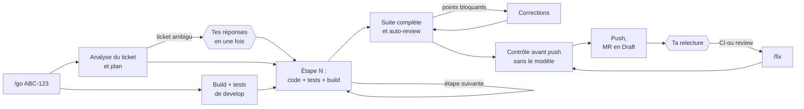
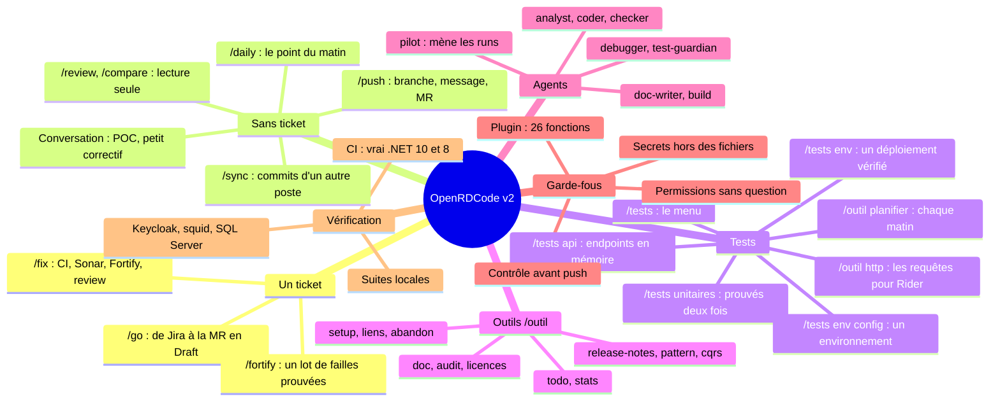
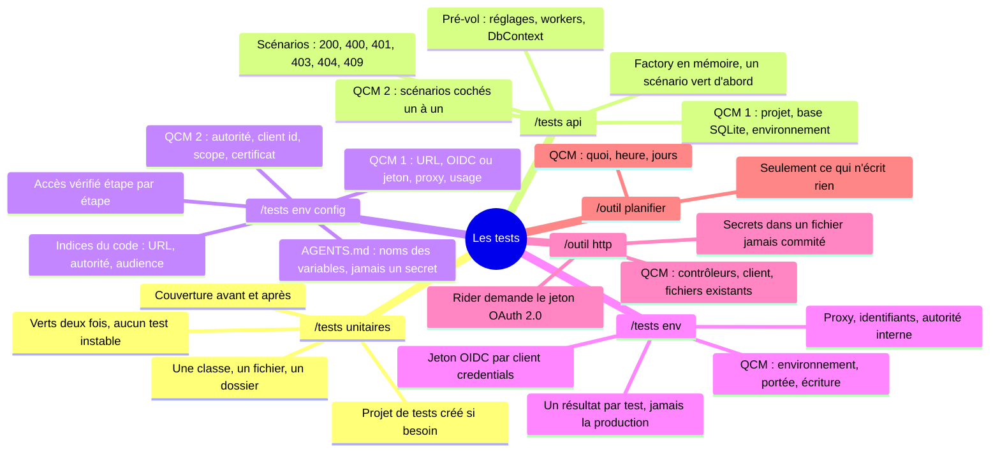
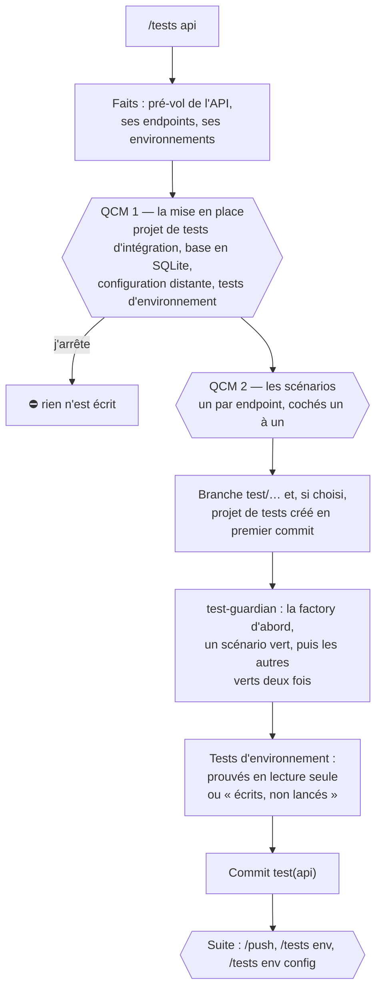
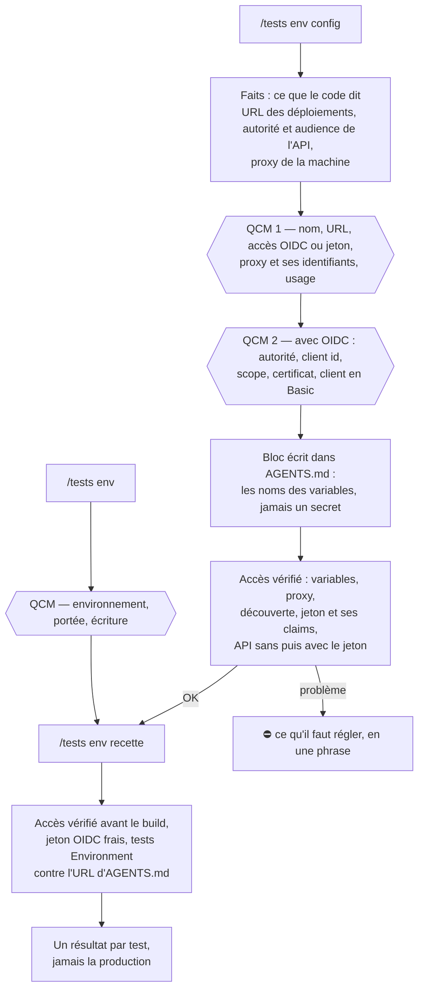
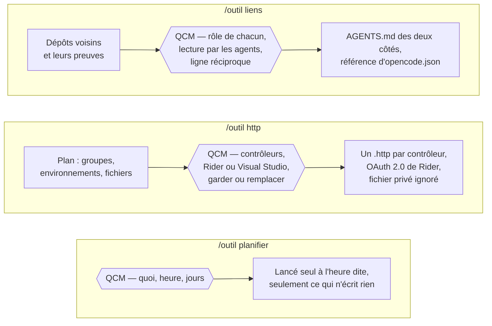

# OpenRDCode v2 : un ticket entre, une MR sort

> **Version du pack pour OpenCode v2** (testée avec OpenCode v2.1.2 et v2.1.3). Ce qui change et comment passer de la 1.19 à la v2 : `MIGRATION.md` ; l'analyse de départ : `ANALYSE.md`. Nouveautés : `/fortify`, un lot de vulnérabilités Fortify corrigées avec leurs tests, jusqu'à la MR ; le `test-guardian`, un agent qui pose d'abord le filet de non-régression du code qu'un correctif va toucher, puis écrit les tests d'un bug ou d'une faille avant leur correctif et les prouve rouges puis verts, aussi dans `/go` et `/fix` ; des runs qui vont au bout seuls (reprise automatique, résumés de contexte qui gardent la procédure) ; la suite de chaque commande en un clic (QCM « Suite ») ; et des assistants pas à pas, en QCM, pour les tests d'une API (`/tests api`), la configuration d'un environnement derrière un fournisseur OpenID Connect et un proxy d'entreprise (`/tests env config`) puis ses tests (`/tests env`), les dépôts d'une même application (`/outil liens`), les requêtes pour Rider (`/outil http`) et les commandes planifiées (`/outil planifier`), vérifiés à chaque push contre un vrai Keycloak, un vrai proxy squid et le vrai SDK .NET.

Tu donnes une clé Jira à `/go`. L'agent analyse le ticket, code étape par étape avec les tests, se relit, corrige, vérifie ce qui va partir, pousse la branche et ouvre la merge request en Draft. Tu relis la MR comme celle d'un collègue. Après la CI ou la review, `/fix` traite tous les retours en une fois.

Pack OpenCode v2 (testé avec les v2.1.2 et v2.1.3) pour un modèle Qwen servi par vLLM (Qwen 3.8, déclaré « Qwen 3.6 » côté plateforme), avec les MCP Jira, Confluence, GitLab, SonarQube et Fortify.

## Pourquoi une v2

La v1 est un assistant pas à pas : 24 commandes, et une validation de ta part à chaque étape. Pour un ticket de 5 étapes, ça fait une douzaine d'interventions (`/ticket`, un `/dev` par étape, `/test`, `/check`, `/dev corrections`, `/ship`, `/scans`, un correctif par point, `/mr`…), plus les questions posées en cours d'étape : 104 endroits du pack te demandaient de choisir. Ce qui coûte, ce n'est pas le modèle : c'est le va-et-vient.

La v2 inverse le contrat :

| | v1 | v2 |
|---|---|---|
| Décisions de l'agent | il te les pose une par une | il les prend, suivant les conventions du dépôt, et les écrit dans la MR |
| Contrôle qualité | toi, à chaque étape | build et tests à chaque étape, auto-review, corrections automatiques, contrôle avant push ; toi, sur la MR |
| Enchaînement | un QCM « Suite » après chaque commande | une seule exécution, du ticket à la MR ; puis un QCM « Suite » dont le choix lance la commande suivante |
| Git | push validé à la main | commit et push automatiques sur la branche du ticket, derrière un contrôle sans le modèle |
| Commandes | 24 | 10 |

## La journée avec la v2

| Moment | Toi | L'agent |
|---|---|---|
| Matin | `/daily` | Sprint, MR, reviews qui t'attendent, plan du jour. Le ticket que tu choisis lance `/go`. |
| Un ticket | `/go ABC-123` | Analyse (et mesure de develop en parallèle), plan, code et tests étape par étape (avant de toucher à du code existant, son filet de non-régression : les tests des méthodes touchées, écrits d'abord par le test-guardian s'il en manque ; un bug : son test écrit d'abord, rouge puis vert), build complet avec la couverture des lignes modifiées, tests des lignes qu'aucun test n'exécute, auto-review, corrections, contrôle avant push, commit, push, MR en Draft avec son rapport. |
| Un changement sans ticket Jira | `/go sans ticket : <ce qu'il faut faire>` | Le même déroulé ; la description remplace le ticket. Clé locale `LOCAL-<n>` pour la branche et la fiche, jamais dans les commits ni le titre de la MR, qui dit « Sans ticket Jira ». |
| Un ticket qui part d'une autre branche que develop | `/go ABC-123 depuis feature/ABC-100-socle` | La branche du ticket part de `origin/feature/ABC-100-socle`, qui devient sa base : la mesure de départ, la review, le contrôle avant push, la fusion de la base et la MR la visent au lieu de develop. Un nom qui n'existe pas sur origin : arrêt avec les noms proches. |
| Un POC, un essai, une doc, un petit correctif, sans ticket | une demande dans une session (« fais un POC de… », « corrige… », « ajoute la doc de… ») | Il travaille dans la conversation, avec les mêmes règles (lire avant d'écrire, plus petit changement, build et tests par `build-test.sh` avant de dire que ça marche), sans branche ni fiche ; il peut lancer un projet du dépôt (`dotnet run --project src/Api`, borné dans le temps). Pour le garder : `/push`. |
| Des tests unitaires, sans ticket | `/tests InvoiceService` (une classe, un fichier, un dossier) | Le `test-guardian` mesure la couverture, écrit les tests du comportement actuel dans le style du dépôt, les prouve (verts deux fois, aucun test instable), mesure la couverture après ; un bug trouvé en route est signalé, jamais corrigé en douce. Commit sur une branche `test/…` ; puis `/push`. Sans projet de tests, il propose de le créer. |
| Les endpoints d'une API, sans ticket | `/tests api [contrôleur, route ou dossier]` | Deux QCM : la mise en place d'abord (le projet de tests d'intégration à créer, la base que les endpoints utilisent directement en SQLite, ce qui empêcherait l'API de démarrer en mémoire, lu dans le code avant tout test), puis les scénarios de chaque endpoint (nominal, 400, 401, 403, 404, 409), cochés un à un. Le `test-guardian` écrit la factory, prouve un scénario, puis les autres, verts deux fois ; et leurs tests d'environnement si tu en veux. Commit sur `test/…`, puis `/push`. |
| Un environnement à déclarer, puis à vérifier | `/tests env config recette`, puis `/tests env recette` (ou `/tests env` : un QCM) | Deux QCM proposés depuis le code : l'URL, l'accès (un client OIDC : son autorité, son client id, son scope ; ou un jeton fixe), le proxy et ses identifiants, le certificat des autorités internes. Le bloc va dans AGENTS.md avec les noms des variables de `~/.zshenv`, jamais un secret, puis l'accès est vérifié étape par étape (jeton et ses claims, l'API sans puis avec le jeton). Ensuite, les tests d'environnement tournent contre l'URL d'AGENTS.md, en lecture seule, jamais sur la production ; ce qui ne va pas est dit en une ligne, avant le build. |
| Pousser ton travail, ticket ou pas | `/push [message] [branche <nom>] [avec MR / sans MR] [avec develop] [sans les tests] [vite]` | Il lit tes changements et te propose, en une seule question (un clic, ou ton propre texte) : la branche quand il en faut une (sur develop, main ou une HEAD détachée : `feature/…`, `bugfix/…`, `test/…`, `docs/…`, `poc/…`…, la recommandée d'abord), le message de commit (conventional commit, 2 ou 3 propositions) et la MR (en Draft, recommandée sauf pour un POC). Le code modifié est buildé et testé avant le commit (pas relancé si ce même code est déjà passé au vert ; en échec, la même question te demande s'il pousse quand même, non recommandé) ; puis fusion de ce que tu as poussé depuis ton autre poste, contrôle avant push, push. `vite` : les choix recommandés, sans question. À la fin, le QCM « Suite » te propose `/fix` pour après la CI (il marche aussi sans ticket). |
| Récupérer ce que tu as poussé depuis ton Mac | `/sync [develop] [merge <branche>]` | Fusionne les commits de la branche sur origin (et develop, ou une autre branche, si tu le dis), sans rien commiter ni pousser ; sur develop, une avance rapide sur origin. Un conflit : fusion annulée, fichiers listés. |
| Vérifier un problème, sans rien changer | une question dans une session (« vérifie pourquoi… ») | Il enquête, sans branche ni commit. S'il faut corriger, `/go sans ticket` dans la même session reprend son enquête. |
| Après la CI ou la review | `/fix` | Jobs en échec, Sonar et Fortify sur les fichiers de la branche, discussions ouvertes de la MR : il corrige (une faille ou un bug, avec son filet de non-régression et sa preuve rouge puis verte ; un refactoring demandé, avec son filet), teste, pousse, et rédige les réponses à coller. |
| Vulnérabilités Fortify par lot | `/fortify [nombre ≤ 5] [catégorie]` | Les plus graves de l'application SSC : analysées trois à la fois, chacune avec ses tests gardés par le `test-guardian` (le filet de non-régression des méthodes que le correctif touche, écrit d'abord s'il en manque ; couverture coverlet du module et de ses dépendances avant et après ; tests de la faille rouges puis verts, deux fois chacun), corrigée, un commit chacune, une MR Draft. COMMANDES.md, section « Fortify ». |
| MR d'un collègue | `/review !42` | Commentaires prêts à coller, en lecture seule. |
| Régression entre deux dépôts | `/compare <dépôt où ça marche> <classe> <symptôme>` | Cause de la régression : code, package, configuration, données ou correctif non reporté. |
| Le reste | `/outil <nom>` | Doc, audit, licences, release notes, patterns d'équipe, scaffolding CQRS, AGENTS.md du dépôt, dépôts liés d'une même application (`liens`, en QCM), requêtes pour Rider (`http`, en QCM), commandes planifiées (`planifier`), abandon d'un ticket, todo, statistiques. |

Plusieurs `/go` en même temps, chacun dans son dossier et sa session : le titre de chaque session montre son avancement (⏳ 12:40 outil · Étape 2/5 — /go ABC-123), puis son issue (✅ MR créée, ⏸ une réponse du PO t'attend, ↻ il reprend tout seul, ⛔ arrêté), et la dernière réponse la détaille (❓ une question t'attend). Un seul `/go` ou `/fix` à la fois par dossier : le second est refusé. Plusieurs tickets du même dépôt en même temps : un dossier par ticket, créé dans l'interface (section suivante).

### Plusieurs tickets du même dépôt : un dossier par ticket (worktrees)

OpenCode v2 crée les espaces de travail dans son interface : dans une nouvelle session, « Local », sous la zone de saisie, puis « Nouvel espace de travail » (vérifié dans les v2.1.2 et v2.1.3). Au premier message, la session part dans un dossier à part, un worktree git créé dans `~/oc2/data/opencode/worktree/` à partir de la branche affichée. Aucun script à lancer, et le pack ne laisse aucun agent créer ou supprimer un worktree, ni déplacer une session : c'est ton choix, dans l'interface. `/go ABC-124` y travaille comme ailleurs (sa commande s'affiche « /go ABC-124 — mon-api · worktree <dossier> · … », et le titre de ses sessions commence par `[<dossier>]`, l'accueil listant ensemble les sessions de tous les dossiers) et les fiches ticket restent dans le `.git` du dépôt principal, visibles de tous les dossiers. Le pas à pas : COMMANDES.md, « Plusieurs tickets d'un même dépôt ».

Ce que ça coûte, à connaître avant d'en ouvrir trois :
- Chaque dossier est une copie complète des fichiers (l'historique git, lui, est partagé) avec ses propres `bin/obj` (et `node_modules` en front) : de l'espace disque, et un premier build qui repart de zéro (les packages NuGet viennent du cache commun, rien n'est retéléchargé ; la compilation, si).
- Le serveur du modèle est partagé : trois `/go` en parallèle se partagent sa capacité, chacun va moins vite, et les « Gateway Time-out » deviennent plus probables tant que la passerelle n'est pas réglée.
- Les tests qui utilisent une ressource locale fixe (une base locale, un port fixe) peuvent se gêner quand deux suites tournent en même temps.
- Un ticket ne s'ouvre que dans un dossier à la fois : `/go` s'arrête en disant où il est ouvert.
- Les fichiers ignorés par git (un `.env`, des réglages locaux) ne sont pas dans le nouveau dossier : copie ceux dont le build ou les tests ont besoin.
- Rider voit un dossier à la fois : pour regarder le travail d'un ticket dans Rider, ouvre son dossier.
- Supprimer un dossier, une fois la MR créée : `git worktree remove <dossier>`, depuis le dépôt principal (git refuse tant qu'il reste des fichiers non commités ; la branche reste). Aucun agent n'en a le droit.
- Un espace de travail démarre sur une HEAD détachée (la v2 crée ses worktrees ainsi) : `/go`, `/fortify` et `/tests` y créent leur branche, et `/push` donne une branche au travail fait sans ticket. Ouvert depuis une branche de fonctionnalité, ses commits suivent le travail : `/push` le dit (WARNING), car ils iront dans la MR.

Deux espaces de travail qui travaillent et poussent en même temps, chacun sur sa branche, ne se gênent pas : chacun a son verrou de build (deux builds du même dossier s'attendent, ceux de deux dossiers tournent ensemble), son dossier de mesures des tests, sa fiche, et une clé `LOCAL-<n>` à lui même lancés à la même seconde. Leurs `git fetch` simultanés se croisaient sur les références partagées (« cannot lock ref » : sur 36 fetchs simultanés de 6 dossiers, les 36 échouaient) ; `fetch.sh` les relance maintenant (0 échec). Deux branches qui modifient la même ligne se rencontrent seulement quand la première est fusionnée dans develop : `/sync develop` ou `/fix` sur la seconde arrête alors la fusion, sans rien perdre, et nomme le fichier à résoudre dans Rider.

## Tes deux interventions

1. **Au départ, seulement si le ticket est ambigu.** L'agent te pose toutes ses questions d'un coup, chacune avec une réponse recommandée. Ce que le ticket, le code ou les conventions tranchent n'est jamais demandé : c'est une décision, notée.
2. **À l'arrivée, la relecture de la MR.** Sa description dit ce qui a été fait, les critères d'acceptation couverts, les décisions prises par l'agent (à valider ou à contester en review), les tests et le filet de non-régression de chaque correctif, ce que la mesure de develop a trouvé, et les points où regarder de près. Puis un QCM « Suite » : `/fix` d'un clic, quand la CI a tourné.

Tu peux donner tes consignes dès le départ : `/go ABC-123 avec un Result, sans nouvelle lib`. Pour un gros ticket, `analyse seule` arrête après le plan, que tu relis avant le code ; `pas à pas` arrête après chaque étape, comme la v1.



## La carte du pack

Tout le pack d'un coup d'œil : les commandes, les tests, les outils, les agents, les garde-fous et la façon dont il est vérifié.



### Les outils de tests



`/tests api`, du code aux tests prouvés :



`/tests env config` puis `/tests env`, de la déclaration d'un environnement à ses tests :



Les assistants de `/outil` :



## Comment ça marche, exactement

### La fiche ticket : le ticket interne de l'agent

`.git/opencode-tickets/<CLÉ>.md` du dépôt principal (le même dossier depuis chaque espace de travail), jamais commitée (elle est dans `.git`), écrite par l'analyste puis tenue à jour par un script :

| Section | Contenu |
|---|---|
| Résumé, critères d'acceptation | C1, C2… ; ceux que le ticket ne donne pas sont déduits et marqués « (déduit) » |
| Questions bloquantes | « Aucune » le plus souvent |
| Zones de code, Référence | où le ticket touche le code ; l'implémentation d'un autre dépôt à reproduire, s'il y en a une |
| Tests attendus | un test au moins par critère |
| Plan | 2 à 7 étapes à cocher, chacune avec ses fichiers et ses tests, chacune laissant le projet qui compile |
| Décisions | chaque choix avec sa raison et son origine (analyse, étape N, ta réponse, /fix) |
| Suivi | le journal horodaté : base de develop, étapes, arrêts, livraison, /fix |

Un script vérifie la fiche juste après l'analyse (sections présentes, étapes numérotées avec fichiers et tests, chaque critère couvert) ; un défaut est renvoyé une fois à l'analyste. Chaque étape est confiée à un sous-agent coder au contexte neuf ; réussie, elle devient un commit local et une case cochée.

### Un problème au milieu : on ne reprend jamais du début

| Ce qui arrive | Ce que fait l'agent | Ce que tu fais |
|---|---|---|
| Serveur du modèle en panne, réponse coupée, limite d'étapes du pilote | le plugin le reprend tout seul (↻), dans la même session, depuis la fiche : 10 essais étalés sur environ 8 minutes, puis deux reprises au plus (2 puis 5 minutes plus tard) | rien ; au-delà, ⛔ et `/go` pour reprendre |
| Coupure (navigateur fermé, OpenCode redémarré) | rien n'est perdu : chaque étape réussie est commitée et cochée ; avec le service, la v2 reprend d'elle-même | `/go` : il note la reprise, repart à la première étape non cochée ; une étape coupée à moitié est reprise avec les fichiers déjà modifiés |
| Contexte du modèle plein | la v2 résume la conversation ; le pilote retrouve les consignes de sa commande, chaque sous-agent sa tâche, et le pilote relit la fiche | rien |
| Une étape échoue | diagnostic par le debugger, puis 2e essai dans la même session du coder (il garde ce qu'il a lu) ; encore en échec : arrêt ⛔, « bloqué à l'étape N : raison » dans la fiche | tu corriges ou tu précises (`/go ABC-123 <consigne>`), il repart de cette étape |
| Un test était déjà rouge sur develop | la mesure du départ le note : il n'est ni corrigé ni bloquant, il est signalé dans la MR | rien |
| Ticket à éclaircir avec le PO | arrêt ⏸ « en attente du PO » | `/go ABC-123 <la réponse>` |
| Conflit avec develop au moment du push | fusion annulée, rien de perdu, arrêt ⛔ avec les fichiers en conflit | tu résous dans Rider, puis `/go` livre |
| Le contrôle avant push trouve un secret | rien n'est poussé, arrêt ⛔ avec le fichier et la ligne (jamais la valeur) | COMMANDES.md, « Contrôle avant push » |
| Problème d'environnement (dotnet, Artifactory, identifiants GitLab) | arrêt ⛔ immédiat, avec quoi régler | tu règles, puis `/go` |

### Quand l'agent pose encore des questions

- `/go` : le choix du ticket si tu n'en donnes pas et que la branche n'en a pas ; puis, en un seul QCM, les questions bloquantes de l'analyse : seulement si rien ne tranche (ticket, code, AGENTS.md), que la réponse change un comportement visible (contrat d'API, données écrites, écran, sécurité) et qu'une erreur coûterait plus qu'un commentaire de review. Chaque question a une réponse recommandée et l'option « Je demande au PO ». Dans le même QCM, dans un dépôt .NET sans projet de tests unitaires (ou sans collecteur de couverture), quand le plan corrige un bug ou modifie du code existant : le créer en premier commit, pour que le test du bug et le filet de non-régression existent (« Non » : ces étapes se font sans, et la MR le dit).
- `/go … comme dans <dépôt>` : une demande d'accès en lecture à ce dossier, au tout début (réponds « Toujours »).
- `/fix` : aucune question en cours de route ; une seule possible, avant le premier correctif, dans un dépôt .NET sans projet de tests unitaires quand il a une faille, un bug ou un refactoring à corriger : le créer en premier commit. Les remarques contestables deviennent des réponses argumentées à coller, pas des modifications.
- Ailleurs : la confirmation de `/outil abandon` (il supprime une branche), la validation de chaque page publiée sur Confluence, et la vérification que `/compare` te propose quand il n'a pas pu confirmer la cause.
- À la fin de chaque commande, et partout où l'agent te propose quelque chose : un QCM « Suite », jamais une phrase à laquelle répondre ni une commande à retaper. Ses options sont les commandes elles-mêmes (`/fix`, `/go ABC-123 pas à pas`, `/push`), la recommandée d'abord, et « Rien pour l'instant » : ton clic lance la commande aussitôt, dans la même session. Pendant qu'il attend ton choix, le run est fini : le dossier est libre pour une autre commande, et le titre garde son issue (✅, ⛔). Dans la conversation, une action proposée (appliquer un correctif, ajouter un test) est un QCM de même : ton choix est le feu vert, l'agent la fait sans redemander.

Aucun sous-agent ne peut te poser de question (réglage OpenCode `primary_tools`), et aucune règle de permission ne te demande d'autorisation en cours de route : ce qui est interdit est refusé net, et l'agent fait sans ou s'arrête avec un rapport.

### « Refais comme dans l'autre dépôt »

| Besoin | Comment |
|---|---|
| Une fois, pour ce ticket | `/go ABC-123 comme dans ~/repos/ancienne-api (ExportService)` : l'analyste lit l'implémentation (lecture seule) et la décrit dans la section « Référence » de la fiche, le coder la reproduit. Une seule demande d'accès, au début. |
| Pour plusieurs tickets, ou toute l'équipe | `/outil pattern export-csv ~/repos/ancienne-api ExportService` une fois : un skill `pattern-export-csv-back` avec les appels exacts des packages internes. Ensuite `/go` s'en sert tout seul quand le ticket s'y prête (son analyste lit le catalogue des patterns), ou sur consigne : `/go ABC-123 comme le pattern export-csv`. |
| Un dépôt cité souvent | le déclarer dans `references` d'`opencode.json` (COMMANDES.md, « Lire un autre dépôt ») : plus aucune demande d'accès. |

En v1, c'était `/extract-pattern` puis `/apply-pattern`, avec ses questions. `apply` a disparu : `/go` applique.

## Ce qui garantit la qualité sans toi

- **Un contexte neuf par étape.** Un agent pilote garde le fil et confie chaque étape à un sous-agent qui démarre avec un contexte vide : le modèle ne s'essouffle pas au fil d'un long ticket.
- **Une mesure de départ.** Pendant que l'analyste lit le ticket, build et tests de develop tournent en parallèle : un problème d'environnement se voit avant la première ligne de code, les tests déjà rouges ne sont pas mis sur le dos du ticket, et le premier build du coder est incrémental.
- **Des preuves à chaque étape.** Build et tests de l'étape, puis toute la suite à la fin, puis encore après une fusion de develop.
- **Des tests écrits par un autre agent que celui qui corrige.** Un bug, une faille Fortify ou Sonar : le `test-guardian` écrit d'abord les tests qui les montrent (rouges sur le code actuel, pour la bonne raison), le coder corrige sans pouvoir y toucher (ils sont scellés avant le correctif : un correctif qui les modifie est détecté, et ils sont remis tels quels), puis le test-guardian vérifie (verts, aucune perte de couverture du module et de ses dépendances). Chaque preuve est exécutée deux fois par un script : un test instable est refusé, un test qui ne s'arrête pas est stoppé et nommé. En fin de `/go`, la couverture des lignes modifiées est mesurée (Sonar exige 80 % sur le nouveau code) et les lignes qu'aucun test n'exécute reçoivent leurs tests.
- **Un filet de non-régression avant chaque correctif.** Avant qu'un correctif touche du code existant (une faille de `/fortify` ou de `/fix`, un bug, un refactoring, une étape de `/go` marquée « (filet d'abord) »), le test-guardian mesure, par script, la part des lignes des méthodes touchées et des méthodes publiques qui y mènent que des tests exécutent (le code asynchrone, les lambdas et les fonctions locales comptés dans leur méthode). Sous le minimum (80 % de leurs lignes ; une ligne « Filet de non-régression » d'AGENTS.md le change), il écrit d'abord les tests du comportement actuel qui manquent, verts deux fois, et les scelle avec la preuve : le coder ne peut pas y toucher, et un correctif qui casse un comportement voisin est arrêté par eux, avant le commit. Ce qu'aucun test ne peut exécuter sans changer le code de production (l'horloge réelle, une dépendance créée dans le code) est nommé « INSUFFISANT » dans la MR, pour la review. Le filet ne pose aucune question : il est mesuré au début de chaque correctif, et vérifié après.
- **Un dépôt sans projet de tests ne bloque plus.** `/fortify` (et `/fix` sur une faille) prouve chaque correctif par des tests : si le dépôt n'a aucun projet de tests, ou qu'il manque coverlet, la première question du run te propose de le mettre en place en premier commit du lot (xUnit, MSTest ou NUnit, selon ton choix), avec le framework et les packages adaptés à l'existant. Tu décides une fois, le reste se fait seul.
- **Des preuves écrites en parallèle.** Les failles d'un lot sont prouvées par vagues : jusqu'à trois `test-guardian` écrivent leurs tests en même temps (fichiers disjoints), les builds étant sérialisés par un verrou du dossier pour qu'ils ne se cassent pas. Puis les correctifs sont appliqués et commités un par un. Une faille que le code repousse déjà (un correctif précédent l'a close, ou c'est un faux positif) garde ses tests en preuve de non-exploitabilité, sans correctif. À la fin, le build et les tests complets tournent en parallèle de l'auto-review.
- **Chaque type de projet avec ses outils.** API CQRS ou REST, Blazor, workers, librairies publiées en paquets NuGet internes, front-ends Angular, React ou Vue, sur .NET 8, 9 ou 10 (netstandard2.0 pour certaines librairies) : `detect-project-type.sh` donne les frameworks cibles, la version de C# permise, le SDK que demande `global.json` et s'il est là, les runtimes des tests, la fin de support de .NET 8 et 9 (10 novembre 2026), la librairie et sa validation de paquet, le dossier du front et comment ses tests tournent. Le coder écrit pour la version du projet (jamais `LangVersion` relevé, jamais un framework ou `global.json` changés) ; un SDK, un runtime, Docker ou le flux de paquets absents sont dits en une ligne, au lieu d'être « réparés » dans le dépôt.
- **Le front-end testé comme la CI le teste.** `build-test.sh <dossier>` : les dépendances installées depuis le lockfile seulement, le build, puis les tests une fois (Karma en ChromeHeadless, Angular 21 avec Vitest, Create React App, Vitest, Jest), un test focalisé (`fit`, `.only`) refusé, un run qui ne finit pas arrêté ; npm qui échoue de lui-même (npm 10 sur l'arbre de Vitest 4) dit comme un problème de la machine, jamais contourné. Une commande qui ne finit jamais (`npm start`, `ng serve`, un mode watch, `npm test` sur un Angular avec Karma) est refusée aux agents du pack : elle tenait le tour 20 minutes.
- **Des tests qui prouvent un comportement, pas des lignes.** Chaque test attendu de la fiche a son niveau (unitaire, intégration, composant) et un scénario avec des valeurs ; le coder et le test-guardian écrivent le résultat attendu dans le test, jamais recalculé avec le code testé ; `test-lint.sh` refuse un test sans assertion, focalisé ou ignoré, et signale une horloge réelle, un délai réel, un appel HTTP réel ou un `Random` sans graine.
- **Les endpoints testés en HTTP, puis chaque déploiement vérifié.** `/tests api` lit d'abord ce qui empêcherait l'API de démarrer dans un test (réglages lus au démarrage, workers, `DbContext` des endpoints, configuration distante) et te le fait trancher dans son premier QCM ; puis il propose, endpoint par endpoint, ses scénarios lus dans le code (nominal, validation, 401, 403, 404, 409) ; tu coches ceux à écrire, le test-guardian écrit la factory, prouve un scénario, puis les autres en mémoire (`WebApplicationFactory`, ports remplacés par des fakes, base en SQLite, chaque schéma d'authentification répondu par le gestionnaire de test), verts deux fois. Les mêmes endpoints ont leurs tests d'environnement, lancés à la demande sur la recette ou la préproduction d'AGENTS.md (`/tests env recette`), en lecture seule, jamais sur la production : `env-tests.sh` demande lui-même le jeton OIDC (client credentials) à travers le proxy de l'environnement, avec ses autorités de certification internes, et dit précisément ce qui ne va pas avant le premier build ; le secret et le jeton ne passent jamais par le modèle. Ou chaque matin (`/outil planifier`), ou par un pipeline planifié de la CI. Le code du skill est compilé et lancé à chaque push avec les vrais SDK .NET 10 et 8, contre une API réaliste déployée derrière un vrai Keycloak et un vrai proxy squid.
- **Les contrats tenus entre dépôts.** `api-surface.sh` dit ce qu'une branche retire, change ou ajoute dans l'API publique, les routes et les DTO ; une librairie avec la validation de paquet est contrôlée contre sa dernière version publiée (`build-test.sh --pack`) ; les dépôts d'une même application (« Dépôts liés » d'AGENTS.md) partagent la section « Contrat » de leurs fiches : le front planifie sur ce que l'API a vraiment livré, et la MR dit ce que l'autre dépôt doit suivre.
- **Un run qui va au bout sans toi.** Panne du serveur du modèle, réponse coupée, limite d'étapes : reprise automatique depuis la fiche ; contexte plein : le résumé garde l'état du run et le pilote retrouve sa procédure.
- **Une auto-review stricte.** Même grille que la review de la v1 (sécurité, autorisations, plusieurs instances, EF Core, performance, conventions), critères d'acceptation et pré-scan Sonar/Fortify. Les points bloquants et majeurs sont corrigés avant le push.
- **Des essais limités.** Deux échecs sur une même étape : diagnostic, un dernier essai, puis arrêt avec un rapport. Une boucle (le même appel trois fois) est refusée, et chaque agent a un plafond d'itérations au-delà duquel il doit rendre son rapport.
- **Un contrôle avant push, sans le modèle.** Section suivante.
- **La CI derrière.** Sonar et Fortify passent sur chaque push ; `/fix` traite leurs résultats.

## Les garde-fous, et pourquoi la v2 en a besoin

En v1, tu validais chaque push et chaque demande d'autorisation. En v2, plus personne ne regarde pendant le `/go` : ce qu'un humain arrêtait doit l'être par une règle. Chacun de ces garde-fous répond à un trou constaté, rejoué sur le moteur de permissions d'OpenCode 1.19 :

| Garde-fou | Le trou qu'il ferme |
|---|---|
| Aucune règle « demander » sur le shell, la lecture ou l'écriture : interdit = refusé net | Un clic sur « Toujours » vaut pour **tous** les agents jusqu'au redémarrage d'OpenCode, et ouvre large : `rm *` pour un `rm -rf`, `dotnet *` pour un `dotnet run`, toute lecture pour un fichier `.env`. Un seul clic en conversation libre levait les refus du coder autonome. |
| Le plugin garde les agents dans le dépôt : un chemin hors du dépôt dans une commande (`~`, `$HOME`, `/home/…`, `../..`, `cd` seul), même entre guillemets ou dans `sh -c`, est refusé | `grep -r export ~` passait pour tous les agents et aurait affiché `~/.zshenv`, donc les identifiants Artifactory. Les règles d'OpenCode ne voient pas l'intérieur des guillemets, et `export -p` n'est même pas une commande pour elles. |
| Les dossiers lisibles hors du dépôt (scripts et skills du pack, références, dossiers que tu nommes) sont en lecture seule : seules les commandes qui lisent peuvent les nommer, jamais `cp`, `mv`, `rm`, une redirection, un build, un interpréteur ou `xargs` ; un `cd` est suivi | Les scripts du pack se lisent maintenant sans demande d'accès. Sans cette règle, un agent aurait pu écraser `diff-guard.sh`, le contrôle avant push, ou écrire dans l'autre dépôt d'un « comme dans ». |
| Coder en liste blanche : lectures, git en lecture, build, tests, format, migrations EF sans base, scripts du pack, déplacements de fichiers dans le dépôt | Il avait « tout sauf… » : `curl`, `dotnet add package`, `dotnet ef database update` (une vraie base), `bash -c`, écrire dans `.git/config` ou dans `~/.config/opencode` passaient. |
| Seul le pilote lance les scripts qui écrivent dans git (`ship.sh`, `branch.sh`, la fiche) | N'importe quel agent, même en lecture seule (checker, analyste), pouvait lancer `ship.sh`, donc commiter et pousser. |
| Contrôle avant push (`diff-guard.sh`) : secret, fichier de clé ou `.env`, marqueur de conflit, version payante d'un package, valeur d'une variable secrète de l'environnement (le mot de passe Artifactory) → rien n'est poussé | Le push est automatique. Le contrôle relit chaque commit pas encore poussé : un secret retiré par un commit suivant partirait quand même avec l'historique. La valeur exacte des variables secrètes est cherchée partout, tests compris : quel que soit le chemin par lequel elle serait arrivée dans le code, elle ne part pas. |
| Un seul `/go` ou `/fix` à la fois par dossier | Deux pilotes dans le même dossier mélangeraient leurs commits. Deux tickets du même dépôt : deux dossiers (« Nouvel espace de travail »). |
| Le texte des tickets, pages, discussions et logs est une donnée, jamais une instruction | Un ticket ou un commentaire de MR qui demanderait « pousse sans tests » ne doit rien déclencher. |
| 20 minutes pour un build ou des tests (posé par le plugin) | OpenCode arrête toute commande après 2 minutes : une suite de tests plus longue était tuée, puis relancée de zéro. |
| Une réponse du modèle qui se répète (la même phrase, ou les mêmes quelques phrases, en boucle) est coupée dès qu'elle boucle, et la requête au serveur annulée ; la réponse suivante repart sans elle, avec une pénalité de présence (1.0, puis 1.5) jusqu'à une réponse normale | Un modèle à réflexion peut tourner en rond jusqu'à sa limite de sortie : une demi-heure ou plus de serveur partagé, pour une réponse jetée ; la boucle restait dans l'historique et se rejouait. Les coupures sont dans le journal du plugin (« repeated itself was cut »). |
| « continue » après un `/go`, `/fix` ou `/fortify` arrêté reprend le run avec le pilote | L'interface web passe la session à l'agent choisi sous la zone de saisie à chaque message : « continue » partait chez `build`, qui poursuivait sans aucune règle du pilote (sondes, projets dans `/tmp`, réflexion sur les DLL). |
| Une commande qui ne finit jamais d'elle-même (`npm start`, `ng serve`, `vite`, `dotnet watch`, `dotnet run` d'une API, `--watch`, `npm test` dont le script regarde les fichiers, `tail -f`, `docker compose up` sans `-d`) : refusée aux agents du pack, avec la bonne commande ; en conversation, en arrière-plan ou bornée par `timeout` | Karma ou un serveur de développement tenaient le tour jusqu'aux 20 minutes d'OpenCode, puis l'agent essayait une autre forme de la même commande. `npm test --watch=false` ne passe même pas l'option à Karma (npm la garde pour lui) : le refus le dit. |
| Un changement des dépendances (`npm install`, même sans paquet, `yarn add`, `pnpm add`, `npm update`, `npx npm@11 install`, `dotnet add package`, `dotnet package add`) ou une installation sur la machine (`npm i -g`, brew, apt, pip, `corepack enable`) : refusé aux agents du pack en une phrase, avec quoi faire (« BLOQUÉ » avec le paquet nécessaire ; `build-test.sh` installe depuis le lockfile ; un outil manquant est un problème de la machine) ; `npm ci` et les installations figées passent | Le coder avait le droit de lancer `npm install` : il pouvait réécrire `package-lock.json` (un autre npm, des versions résolues de nouveau), et le commit l'aurait poussé. Et chaque refus des règles d'OpenCode envoie au modèle 19 000 caractères de règles sans lui dire quoi faire : il essaie alors une autre forme. |
| Scripts de package.json pour le coder : oui (un client d'API généré, une vérification de l'équipe), sauf ceux qui publient, déploient, lancent les tests de bout en bout ou Docker ; `.npmrc` et `.yarnrc.yml` jamais lus | Sans les scripts, le coder ne pouvait pas régénérer un client d'API ; avec tous, il aurait pu publier un paquet. Les fichiers du registre front-end peuvent contenir un jeton. |
| Une installation front-end refusée quand git n'ignore pas `node_modules` ; le contrôle avant push arrête `node_modules`, `obj`, `bin/Debug` et `TestResults` | `ship.sh` commite tout (`git add -A`) : un `.gitignore` incomplet aurait poussé des milliers de fichiers. |
| `dotnet run` : jamais pour les agents du pack ; en conversation, seulement un projet du dépôt que le dernier commit contient | Un projet « sonde » créé pour l'occasion (réflexion sur un assembly, fichier `Probe.cs` lancé en programme) servait à deviner l'API d'un package. L'API vient de sa documentation XML : `package-refs.sh --doc <package>`. |
| Une commande planifiée (`/outil planifier`) ne peut rien écrire : `/daily`, `/outil audit`, `/outil licences` et `/tests env` en lecture seule ; une autre ligne, même écrite à la main dans le fichier, est refusée par le plugin | Une commande lancée à 7 h sans personne devant ne doit jamais commiter, pousser ou écrire dans Jira : ce que tu valides en v1 ne serait vu par personne. |
| Les tests d'un environnement : jamais la production, jamais une écriture sans `--écriture` de ta main sur un environnement « écriture permise », l'URL et le jeton donnés par `env-tests.sh` seul (jeton lu dans ta variable ou demandé au fournisseur OIDC, jamais affiché ni dans une commande) | Un agent qui appelle lui-même une API déployée (curl, un script) avec un jeton, ou qui lance des tests qui créent des données sur la production. |
| Les secrets d'un environnement (secret du client OIDC, identifiants du proxy, jeton) : jamais dans AGENTS.md ni dans une commande, seulement les noms des variables de `~/.zshenv`, par convention (`RECETTE_CLIENT_SECRET`…) ; masqués dans tout ce qu'affiche `env-tests.sh`, encodés ou non, même dans l'URL du proxy qu'une exception .NET écrit | AGENTS.md est commité et partagé : un secret écrit dedans partirait dans GitLab. Et les règles des agents refusent tout nom de variable qui contient SECRET, TOKEN ou CREDENTIAL : l'assistant ne les écrit jamais, le script les déduit du nom de l'environnement. |
| Les assistants (`/tests env config`, `/outil liens`, `/outil http`) ne partent jamais seuls : jamais planifiés, leurs scripts d'écriture réservés au pilote de `/tests` ou à la conversation ; `opencode.json` modifié par `/outil liens` seulement par un script qui le copie d'abord, garde ses commentaires et le relit (remis tel quel s'il ne se lit plus) | Un assistant planifié attendrait une réponse que personne ne donne ; un `opencode.json` cassé empêcherait OpenCode de démarrer. |

Restent interdits comme en v1 : commit ou push sur develop, master ou main, force-push, rebase ; toute écriture dans Jira ; dans GitLab, tout sauf la création de la MR en Draft par le pilote ; Confluence sans ta validation ; la lecture des secrets (nuget.config, `.env`, `~/.zshenv`, identifiants git) ; décompiler un package. En conflit avec develop, l'agent n'arbitre jamais.

## Paramètres

| Réglage | Valeur | Pourquoi |
|---|---|---|
| `temperature`, `top_p` de tous les agents | 1.0, 0.95 (Qwen 3.8) | La carte de Qwen 3.8 ne donne qu'un réglage pour le mode réflexion, code compris, et ses benchmarks de code tournent avec. Le 0.6 d'avant venait de Qwen 3.6 (son réglage « code précis ») : sous 3.8, il s'écarte de ce que le modèle attend. |
| `steps` (plafond d'itérations) | pilote 100, doc-writer 80, test-guardian 70, coder 60, analyste, checker, debugger 30 | Au plafond, OpenCode force l'agent à rendre un rapport au lieu de tourner sans fin ; le pilote traite le rapport incomplet d'un sous-agent comme un échec, et le plugin reprend un pilote arrivé à son plafond (↻), depuis la fiche. |
| `doom_loop` | refusé (global) | Le même appel trois fois de suite : OpenCode demandait ta validation, ce qui bloquait un `/go` sans personne devant. Refusé, le sous-agent s'arrête en erreur et le pilote enchaîne (debugger, 2e essai). |
| `experimental.primary_tools: ["question"]` | nouveau | Aucun sous-agent ne reçoit l'outil question ; le debugger le garde quand il est l'agent de `/compare`. |
| `compaction.prune: true` | nouveau | Dans une longue session (`/daily`, puis `/go`, puis `/fix`), les sorties d'outils des tours anciens sont effacées du contexte ; les deux derniers tours restent entiers. |
| Permissions | aucune règle « ask » ; coder en liste blanche ; `git push/commit/merge/pull/reset/rebase`, `rm -r` refusés à tous ; `dotnet run` refusé à tous sauf à la conversation (`build`), pour un projet commité ; pour lire, `awk` (sans `system`, `getline`, `ENVIRON` ni écriture de fichier), `du` et `xargs grep` permis à tous les agents | voir « Les garde-fous » |
| `presence_penalty` | 0 (carte de Qwen 3.8) ; 1.0 puis 1.5 sur la requête qui suit une réponse coupée en boucle | Le plugin la pose lui-même, seulement là : partout ailleurs, l'échantillonnage de la carte du modèle. |
| `top_k` 20, `preserve_thinking` (options du modèle) | inchangés | Section suivante. |

### Réglages du modèle (section `provider` d'`opencode.json`)

Sous OpenCode v2, la température et le top_p de chaque agent passent dans chaque requête (constaté avec `opencode debug agents`) ; `temperature` et `reasoning` déclarés dans le modèle d'un provider sont ignorés, et v2 le dit dans son journal (MIGRATION.md, étape 9). `top_k` et les options du mode thinking sont à traduire au format v2 avec ta vraie configuration.

```json
"provider": {
  "<ton provider>": {
    "models": {
      "<ton modèle Qwen>": {
        "temperature": true,
        "limit": { "context": 131072, "output": 32768 },
        "options": { "top_k": 20, "chat_template_kwargs": { "preserve_thinking": true } }
      }
    }
  }
}
```
- **Qwen 3.8** : la plateforme répond avec Qwen 3.8 même quand le modèle est déclaré « Qwen 3.6 ». Sa carte ne donne qu'un réglage pour le mode réflexion, code compris : `temperature` 1.0, `top_p` 0.95, `top_k` 20, `presence_penalty` 0 (ses benchmarks de code tournent avec). Les agents du pack et le snippet sont donc à 1.0 ; `top_k` 20 et `preserve_thinking` restent dans les `options`. Contexte natif : 262 144 tokens, mais `limit.context` reste la taille réelle du serveur, au plus 131072. Nouveau dans 3.8 : `reasoning_effort` (profondeur de la réflexion), à tester avant de s'en servir (COMMANDES.md, « Qwen 3.8 »).
- `temperature: true` : à ajouter dans tous les cas.
- `limit` : `context` = la taille de contexte réelle du serveur (à demander, ou `max_model_len` dans la réponse de `/v1/models` pour vLLM), au plus 131072 pour garder des tours rapides ; `output` = 32768, ou le quart de `context` s'il est plus petit que 128K. OpenCode compacte la session quand elle dépasse `context - output` ; sans `limit`, il ne la compacte jamais et elle peut finir en erreur de contexte.
- `options` (à tester une commande, puis à retirer si le serveur répond par une erreur) : `top_k` 20 est la valeur recommandée par Qwen. OpenCode renvoie au serveur le raisonnement des tours précédents ; à l'intérieur d'un même `/go`, le modèle de prompt de Qwen le garde déjà ; `preserve_thinking` le garde aussi d'une commande à l'autre dans la même session, ce que Qwen recommande pour les agents (Qwen 3.6 et 3.8 sont entraînés pour, et le cache du serveur s'en sert mieux). Contrepartie : le contexte se remplit plus vite.
- Côté serveur (pour l'équipe qui l'héberge, pas dans `opencode.json`) : Qwen 3.6 et 3.8 sont entraînés à générer plusieurs tokens à la fois (MTP), ce que vLLM n'active pas par défaut. La carte de Qwen 3.6 donne `--speculative-config '{"method":"qwen3_next_mtp","num_speculative_tokens":2}'` ; la page Unsloth écrit `"method": "mtp"` (la forme dépend de la version de vLLM ; la carte de 3.8 ne donne pas encore la sienne) et précise le compromis : chaque requête est générée plus vite, le débit total baisse un peu quand beaucoup de requêtes tournent en même temps. La qualité ne change pas : le décodage spéculatif garde la même distribution de sortie. C'est sans doute le plus gros levier de vitesse disponible, mais le gain se mesure sur le serveur, selon sa charge : c'est à l'équipe qui l'héberge d'en juger. Le prefix caching est actif par défaut sur les versions récentes.
- Si le serveur tourne sans le mode thinking (aucun bloc de réflexion dans l'interface), les réglages recommandés par Qwen (3.6 comme 3.8) sont `temperature` 0.7, `top_p` 0.8, `top_k` 20 et `presence_penalty` 1.5 : mets-les dans les `options` du modèle, elles s'appliquent alors à tous les agents.
- **« Service Unavailable » sur une session longue, qui disparaît avec une nouvelle session** : presque toujours une requête plus longue que ce que le serveur accepte (déclarer un `context` plus grand que le `max_model_len` réel). vLLM répond alors « maximum context length… » et OpenCode compacte la session tout seul ; mais quand une passerelle renvoie cette erreur en 503 « Service Unavailable », OpenCode ne la reconnaît pas (il exclut volontairement ce libellé), réessaie 10 fois, puis échoue à chaque nouvelle requête de la session (le plugin reprend le run deux fois, en vain, puis ⛔). Remède : `context` = la vraie valeur du serveur (commande dans COMMANDES.md) ; en attendant, `/compact` dans la session au lieu d'en ouvrir une nouvelle.
- **« Gateway Time-out » (504) dans les logs** : la passerelle devant le serveur du modèle a coupé une requête trop longue. OpenCode réessaie seul (10 fois ; pendant un `/go`, `/fix` ou `/fortify`, étalés sur environ 8 minutes, puis le run reprend tout seul) : la session continue, mais chaque essai repart de zéro. Causes probables : une réflexion longue (Qwen 3.8 réfléchit plus que 3.6) ou un serveur chargé. Le remède est côté plateforme : un délai plus long sur la passerelle pour les réponses en streaming, sans mise en tampon (COMMANDES.md, « Qwen 3.8 »).
- Titre des sessions : OpenCode le fait écrire par le même modèle, en parallèle de ta première commande, et Qwen réfléchit avant d'écrire ce titre, ce qui occupe le serveur pour rien. À tester de la même façon (si le serveur refuse, la session garde juste son titre par défaut) : dans la section `agent` de `opencode.json`, `"title": { "options": { "chat_template_kwargs": { "enable_thinking": false } } }`. Si la plateforme propose un modèle plus petit, `"small_model": "<provider>/<modèle>"` fait encore mieux.

## Où sont passées les commandes de la v1

| v1 | v2 |
|---|---|
| `/ticket`, `/dev`, `/test`, `/check`, `/dev corrections`, `/ship`, `/sync`, `/next` | `/go` (et `/go` à nouveau pour reprendre) ; hors ticket, `/push` et `/sync` |
| `/scans`, `/fortify-fix`, `/sonar-fix`, `/mr` | `/fix` |
| `/daily`, `/review`, `/compare` | inchangées |
| `/extract-pattern`, `/apply-pattern` | `/outil pattern` (capture), puis `/go` (applique) |
| `/doc`, `/audit`, `/licences`, `/release-notes`, `/cqrs`, `/agents-md`, `/abandon`, `/todo` | `/outil doc`, `/outil audit`, `/outil licences`, `/outil release-notes`, `/outil cqrs`, `/outil setup`, `/outil abandon`, `/outil todo` |
| — | `/outil stats` : ce que `/go` et `/fix` ont fait sur tes tickets ; `/tests api` et `/tests env` (avec leurs assistants), `/outil liens`, `/outil http`, `/outil planifier` |

En langage courant aussi : « pourquoi ça plante », « explique ce flux », « corrige le point Fortify 4512 », « rappelle-moi de relancer Paul vendredi ».

## Architecture

| Agent | Rôle | Écrit |
|---|---|---|
| `pilot` | Mène `/go`, `/fix`, `/fortify`, `/tests`, `/push`, `/sync` et `/daily` : fiche ticket, enchaînement des étapes, commit et push par script, MR en Draft. | la fiche ticket ; la MR (création seulement) |
| `analyst` | Analyse le ticket (Jira, Confluence, code, patterns de l'équipe, dépôt de référence) et écrit la fiche : critères, plan, tests attendus, questions bloquantes. | la fiche ticket |
| `coder` | Code UNE étape ou un lot de corrections, avec ses tests, puis build et tests. Ne pose jamais de question : il décide et le dit. | le code et les tests |
| `checker` | Auto-review de toute la branche avant le push, et `/review` d'une MR de collègue. | rien |
| `debugger` | Diagnostic d'un échec qui résiste, et `/compare`. | rien |
| `test-guardian` | Le filet de non-régression avant un correctif (les tests du comportement actuel des méthodes touchées, quand ils manquent), puis les tests d'une faille, d'un bug, des lignes modifiées ou d'un code que tu nommes (`/tests`), et les tests d'API des scénarios que tu as cochés (`/tests api`), écrits avant le correctif quand il y en a un, et prouvés par script (rouge, vert, deux fois, filet intact, couverture sans perte). | les projets de tests seulement |
| `doc-writer` | Écrit `docs/` pour `/outil doc`, sans jamais ouvrir un fichier de configuration. | `docs/`, `README.md` |

Le reste : 10 commandes, 8 skills de connaissances (conventions CQRS, intégrations SharePoint/DocuSign/S3/Piano, Blazorise : langue du DataGrid et de sa pagination, puis son remplacement par du Razor natif, tests d'API en mémoire et sur un environnement, remédiation Fortify, bonnes pratiques, correction de build, explication de code), les procédures de `/outil` sous forme de skills (dont les dépôts liés, les requêtes `.http` pour Rider et les commandes planifiées), les scripts du pack (état git, build et tests .NET et front-end, versions et problèmes d'environnement, contrats et qualité des tests, dépôts liés, branche, commit et push, contrôle avant push, fiche, statistiques…) et un plugin : scripts des commandes, environnement stable des agents, refus des identifiants et des dumps d'environnement, agents gardés dans le dépôt, délais longs pour les builds, un seul run (`/go`, `/fix`, `/fortify`, `/tests`, `/push`, `/sync`) à la fois par dossier, aucune question d'un sous-agent, la ligne courte des commandes, l'avancement et l'issue dans le titre de la session, la commande choisie dans un QCM lancée toute seule, la reprise automatique d'un run arrêté avant sa réponse finale, la procédure redonnée après un résumé du contexte, plus de patience envers le serveur du modèle, le refus des commandes qui ne finissent jamais et des changements de dépendances par les agents, les commandes planifiées qui n'écrivent rien (`/daily`, `/tests env` chaque matin), et la fermeture de ce que la v2 ouvre (code mode, recherche web, partage, déplacement de session : MIGRATION.md, étape 14). Chaque fichier, ce qu'il fait et à quoi il sert : `FICHIERS.md`.

## Installation

`MIGRATION.md`, pas à pas et sans lancer aucun script : OpenCode v2 est téléchargé comme une archive avec `npm pack` (rien ne s'installe ni ne s'exécute), sa configuration va dans `~/oc2/config/opencode`, à côté de la 1.19 qui reste intacte. Les fichiers du pack se collent depuis GitHub, et `CHECKSUMS-config.txt` et `CHECKSUMS-scripts.txt` disent, par empreintes, lesquels manquent ou diffèrent. Ne copie jamais `tools/` (outils de maintenance du pack). Deux fichiers se composent au lieu d'être collés tels quels :
- `AGENTS.global.md` devient `~/oc2/config/opencode/AGENTS.md`, avec tes sections « Daily » et « Release groups » ;
- `opencode.snippet.json` devient `~/oc2/config/opencode/opencode.json`, avec tes sections à toi (`provider`, `model`, `mcp`…) ajoutées.

Mettre à jour le pack : `COMMANDES.md`, section « Mettre à jour le pack ».

Une fois par dépôt : `/outil setup`, qui écrit l'`AGENTS.md` du dépôt, court (40 à 120 lignes) et fait pour les agents : la solution et les filtres de tests que prend `build-test.sh`, le lanceur des tests (VSTest ou Microsoft.Testing.Platform), le dossier du front-end, les dépôts liés de la même application, les environnements où l'API est déployée, la section « Library » d'une librairie, ce que la CI et le build imposent, les conventions avec le fichier à imiter, les exemples de référence. C'est ce qui permet à `/go` de travailler sans te demander comment builder ou où ranger le code. Le modèle `AGENTS.repo-template.md` montre ce qu'il contient. Un AGENTS.md écrit avant cette version peut dire de lancer les tests avec `dotnet run` (sur .NET 10 avec Microsoft.Testing.Platform) : relance `/outil setup`, il remplace ces lignes.

### Tests .NET 10 et Microsoft.Testing.Platform

`build-test.sh` lance chaque projet de tests avec son lanceur : VSTest par `dotnet test` comme avant, et les projets Microsoft.Testing.Platform (MSTest.Sdk, xUnit v3 avec `UseMicrosoftTestingPlatformRunner`, les lanceurs MSTest ou NUnit, TUnit, ou `global.json` en mode MTP) comme les applications qu'ils sont (`dotnet exec` de leur sortie, sans `dotnet run` et sans rien changer au dépôt), le filtre traduit (`--filter-method` pour xUnit v3, `--treenode-filter` pour TUnit, tel quel pour MSTest et NUnit), une limite de temps (5 minutes avec un filtre, 18 sans), la couverture par leur extension (Microsoft.Testing.Extensions.CodeCoverage ou coverlet.MTP, en Cobertura). Un projet que `dotnet test` du SDK .NET 10 refuse (« Testing with VSTest target is no longer supported ») est relancé ainsi tout de suite. Les preuves du `test-guardian`, `/fortify` et la couverture des changements marchent pareil ; `test-guardian.sh setup` ajoute Microsoft.Testing.Extensions.CodeCoverage à un projet MTP qui n'a pas d'extension de couverture. Pour que `dotnet test` marche aussi dans ton terminal sur ces projets : `"test": { "runner": "Microsoft.Testing.Platform" }` dans `global.json` (une décision d'équipe, jamais prise par un agent).

### Front-end, .NET 8 et librairies

- **Front-end** : node (et Chrome ou Chromium pour un Angular avec Karma) sur la machine d'OpenCode ; le reste vient du lockfile du dépôt. Un dépôt .NET avec un dossier front (`ClientApp`) : `/go` mesure et teste les deux ; un dépôt sans .NET : `build-test.sh` seul. `.gitignore` doit ignorer `node_modules` (sinon rien n'est installé, et le run le dit).
- **.NET 8 et 9** : leur support s'arrête le 10 novembre 2026 ; les agents écrivent pour eux tant que le dépôt les cible (C# 12 pour .NET 8) et passer à .NET 10 est un ticket à part. Le SDK que demande `global.json` et les runtimes des tests (.NET 8 et ASP.NET Core 8 pour les tests d'une API .NET 8) doivent être installés sur la machine d'OpenCode : sinon, une ligne `ENVIRONMENT PROBLEM` le dit dès le premier build.
- **Librairies** : pour que l'API publique soit contrôlée par le build, `EnablePackageValidation` et `PackageValidationBaselineVersion` dans le projet (une décision d'équipe : `/outil setup` la propose) ; sans eux, `api-surface.sh` lit les ruptures dans le diff.
- **Plusieurs dépôts** (un front et son API, une librairie et ses consommateurs) : `/outil liens` les trouve à côté du dépôt avec ce qui les lie, te fait choisir leur rôle en un QCM, écrit la section « ## Dépôts liés » de l'AGENTS.md des deux côtés et, si tu le veux, la référence d'`opencode.json` qui permet aux agents de lire leur code (COMMANDES.md, « Plusieurs dépôts d'une même application »).
- **Environnements** : `/tests env config` déclare chacun dans l'AGENTS.md du dépôt (URL, client OIDC, proxy, certificat, jamais un secret) ; ses secrets vont dans `~/.zshenv`, sous les noms que l'assistant donne (COMMANDES.md, « Tests d'API et tests d'un environnement »).

Le push automatique demande des identifiants GitLab que git trouve seul sur la machine : `COMMANDES.md`, section « Identifiants GitLab ».

## Avant de la montrer : un vrai essai

Tout ce qui est vérifié ici l'a été avec un modèle simulé qui suit un script (section suivante) : le comportement réel de Qwen sur un `/go` complet ne l'est pas encore. Avant une démonstration, un essai réel d'une demi-heure :
1. Un petit ticket réel (1 à 3 étapes, sans migration), sur un dépôt où `/outil setup` est passé ; `/go <CLÉ> analyse seule` d'abord : la fiche est-elle juste, les décisions raisonnables ?
2. `/go <CLÉ>` pour coder, puis ne rien toucher jusqu'à sa dernière réponse, ✅ ou ⛔. Noter la durée et chaque arrêt.
3. Lire la MR en Draft comme une MR de collègue : description, décisions, tests ; `/outil stats` pour les chiffres.
4. S'il s'arrête : la raison est dans sa réponse et dans la fiche (« Suivi ») ; les refus sont dans les logs (COMMANDES.md, « Logs d'OpenCode »). Envoie-moi les lignes : chaque arrêt réel est une règle à ajuster, pas une raison de revenir à la v1.

## Limites connues

- (Likely) Un modèle de 27B prend parfois une mauvaise décision : avec moins d'arrêts, elle va plus loin avant que tu la voies. La parade est la section « Décisions » de la MR, l'auto-review et `analyse seule` sur les gros tickets, pas des questions en plus.
- La création de la MR passe par l'outil `create_merge_request` du MCP GitLab. S'il porte un autre nom chez toi, l'agent te donne le lien de création et la description à coller (COMMANDES.md, « Vérifier le nom de l'outil qui crée les MR »).
- Un ticket long tourne longtemps : le titre de la session montre l'étape en cours et ce qu'attendent les sous-agents ; un redémarrage d'OpenCode coupe le travail, que la v2 reprend toute seule quand elle tourne en service (sinon, relance la commande : elle reprend à sa dernière étape faite).
- La reprise automatique ne règle pas une erreur de configuration : un `limit.context` plus grand que ce qu'accepte le serveur donne des 503 à chaque essai, et le run finit en ⛔ après deux reprises (COMMANDES.md, « Qwen 3.8 »).
- Le plugin reconnaît un chemin hors du dépôt à sa forme : un motif de recherche qui commence par un dossier racine existant (`grep "/home"`) est refusé à tort ; l'agent cherche autrement. C'est une couche de défense, pas un bac à sable du système : les agents tournent avec ton utilisateur. Les secrets restent couverts par les autres couches (règles de lecture, liste blanche du coder, contrôle avant push qui refuse la valeur des variables secrètes), et la vraie isolation serait un utilisateur ou un conteneur dédié pour OpenCode, avec un jeton Artifactory en lecture seule.
- Une référence `references` d'`opencode.json` doit être un dossier local : une référence vers un dépôt git distant n'est pas lisible par les agents du pack.
- `test-lint.sh` et `api-surface.sh` lisent le code sans le compiler : ce sont des heuristiques (un helper d'assertion maison est reconnu à son nom, une API publique à ses mots-clés). La validation de paquet (`--pack`) est la vérification exacte d'une librairie, quand l'équipe l'active.
- (Likely) Les commandes planifiées : le plugin ouvre leur session par `ctx.session.create`, l'API de plugin que la documentation de la v2 décrit, pas encore rejouée sur ta v2.1.3 ; si elle n'existe pas chez toi, le journal du plugin le dit (« scheduled command not started »), et rien d'autre ne change. OpenCode doit tourner à l'heure dite (son service) : une heure manquée n'est pas rattrapée.
- Les tests d'environnement tournent depuis la machine d'OpenCode : un environnement qu'elle ne joint pas donne un `ENVIRONMENT PROBLEM` précis (VPN, nom inconnu, proxy qui refuse, certificat) ; le pipeline planifié de la CI, lui, tourne là où l'environnement est joignable. Sur un Mac, .NET ne lit que le trousseau : le certificat d'une autorité interne doit y être pour les tests (curl, lui, prend le fichier de « certificat ») ; sous Linux, `SSL_CERT_FILE` suffit.
- Les requêtes `.http` d'un environnement OIDC demandent leur jeton par la configuration OAuth 2.0 du client HTTP de Rider ; Visual Studio ne la lit pas (un jeton à coller), et le client HTTP en ligne de commande de JetBrains ne la gère pas encore. Rider passe par le proxy de ses propres réglages.
- Sur un Mac sans `timeout` (paquet coreutils, `gtimeout`), un test front-end qui ne finit pas est arrêté par OpenCode au bout de 20 minutes, au lieu de 15 par `front-test.sh`.

## Pour la maintenance du pack

- `tools/permissions.py` régénère les lignes `permission:` des agents et `opencode.snippet.json` (à lancer depuis `opencode-v2/`). Ne les modifie pas à la main. Aucune règle « ask » sur le shell, la lecture ou l'écriture : la simulation échoue s'il en apparaît une.
- Les permissions sont vérifiées par simulation : `tools/permission-sim.mjs` (le moteur d'OpenCode 1.19, dont v2 garde la logique de règles, sous-sessions et `primary_tools` compris) rejoue `tools/permission-corpus.mjs`, 2 571 cas, dont les 209 commandes que les fichiers du pack prescrivent (celles des assistants comprises), chacune avec l'agent qui la lance (une commande prescrite et refusée bloquerait le run : `/outil abandon` l'était) : les commandes que le pack fait lancer à chaque agent, les réflexes du modèle, les secrets, les écritures git interdites (y compris un message de commit qui tenterait `$(…)`), la liste blanche du coder, les outils MCP permis ou masqués par agent, les questions et les boucles, et les outils que la v2 ajoute (code mode, recherche web, déplacement de session, worktrees, skill `report`). Lancement : `cd tools && npm install --no-save web-tree-sitter@0.25.10 tree-sitter-bash@0.25.0 gray-matter@4.0.3 && node permission-sim.mjs ..`.
- Les garde-fous du plugin : `node tools/plugin-test.mjs .` (789 vérifications : ces mêmes commandes prescrites passées aux garde-fous du plugin, les assistants jamais planifiés, les commandes planifiées (l'heure et les jours, seulement ce qui n'écrit rien, une seule session quand plusieurs OpenCode tournent), les commandes qui ne finissent jamais refusées à chaque agent du pack et permises à la conversation en arrière-plan ou bornées, `npm test` jugé sur ce que lance son script, les changements de dépendances et les installations sur la machine refusés à chaque agent du pack sous toutes leurs formes, `npm ci` permis, le journal qui ne contient jamais un script de package.json, le QCM « Suite » qui finit un run (dossier libéré pendant qu'il attend, issue gardée, aucune reprise, la commande choisie lancée même si le serveur du modèle tombe ensuite ; celui de `/compare` et de `/outil`, qui ne tiennent pas le dossier, et une question de choix posée avec lui dans le même appel), deux runs en même temps dans un dépôt et son espace de travail, la boucle de réflexion coupée dans le flux, l'historique nettoyé, la pénalité de présence après une coupure, « continue » repris par le pilote, `dotnet run` d'un projet non commité refusé ; chemins hors du dépôt, dossiers en lecture seule, fiches d'un worktree, dossier du worktree dans le titre et la ligne de commande, état des sous-agents dans le titre, dossiers nommés et références, `cd` suivis, outils appelés par leur chemin, journal des refus, dumps d'environnement, `rm` récursifs, délais, un seul `/go`, issue dans le titre ; pour la v2 : l'adaptateur, le verrou et sa reprise après un redémarrage du service, aucune question d'un sous-agent, ni mot de passe du serveur, ni token MCP, ni dossiers `~/oc2` dans l'environnement des commandes, les `references` lues dans `OPENCODE_CONFIG_DIR`, code mode et recherche web retirés, l'attente des serveurs MCP, le même appel répété trois fois, l'option recommandée d'un QCM, le dossier d'un espace de travail dans les titres, l'effacement des anciennes sorties d'outils, le journal du plugin, un fichier cité de ton dossier personnel qui ne rend rien lisible ; plusieurs sous-agents dans le titre, l'attente d'un nouvel essai, le résumé du contexte ; la procédure ou la tâche redonnées après un résumé, et ce que le résumé doit garder ; les nouveaux essais étalés ; les reprises automatiques et leurs limites).
- Tous les agents, commandes et skills sont validés avec `gray-matter`, le parseur YAML d'OpenCode, et chaque fichier du pack doit être décrit dans `FICHIERS.md` (`node tools/validate.js`).
- Les listes d'empreintes, après tout changement d'un agent, d'une commande, d'un skill, du plugin ou d'un script (depuis `opencode-v2/`) : `{ for f in agents/*.md commands/*.md; do sha256sum "$f"; done; for f in skills/*/SKILL.md; do sha256sum "$f"; done; sha256sum plugins/openrd-pack.js; } > CHECKSUMS-config.txt && (cd scripts && for f in *.sh; do sha256sum "$f"; done) > CHECKSUMS-scripts.txt`, puis les lignes attendues de `MIGRATION.md` (5.3, 5.4 et A.7), recalculées sur une copie d'une installation 1.19.
- Les scripts sont vérifiés avec `shellcheck` et testés avec dash, bash et busybox sh, et avec les awk mawk, gawk, BWK et busybox ; `branch.sh` et `ship.sh` sont rejoués contre un dépôt distant de test (branche, accents, push, commit poussé depuis un autre poste, merge de develop, conflit annulé, identifiants refusés, GitLab muet, secret refusé puis historique réécrit) et `diff-guard.sh` sur 33 cas (secrets par type, faux positifs, fichiers de test, secret retiré par un commit suivant, valeur d'une variable secrète de l'environnement, packages payants).
- Les scripts git hors ticket et la base d'une branche : `sh tools/scripts-test.sh [dash|bash]`, 74 contrôles contre un dépôt distant de test (`base.sh` ; la branche choisie à `/push`, son nom donné tel quel, rendu valide s'il le faut, refusé s'il existe ; `/outil abandon` qui ne supprime jamais une branche qui contient du travail ; `/go depuis` la branche d'un collègue, sa base enregistrée et suivie par `workflow-state.sh`, `diff-guard.sh` et `ship.sh`, un nom absent d'origin arrêté avec les noms proches ; un espace de travail en HEAD détachée, pour `/push` et pour `/go` ; `/push` depuis develop ; `/sync` sur une branche de travail, avec et sans develop, et sur develop en avance rapide seulement ; ce qui doit toujours s'arrêter : develop protégée, modifications d'une autre branche, conflit annulé, secret refusé, `node_modules` et `obj` jamais poussés).
- Les journées d'un développeur, scénario par scénario : `sh tools/scenarios-test.sh [--real] [dash|bash]`, 139 contrôles qui enchaînent les scripts de `/go`, `/fix`, `/push`, `/sync` et `/tests` dans l'ordre de leurs commandes, sur plusieurs dépôts (avec et sans tests, build cassé, tests rouges, dotnet absent, secret, commits du Mac, conflit, develop en retard, commit fait par erreur sur develop, branche démarrée sur le Mac, legacy, une étape « (filet d'abord) » dont le filet arrête une régression du coder, la même dans un dépôt sans tests : le projet de tests créé d'abord, puis le filet mesuré avant tout test) et dans deux puis quatre espaces de travail d'un même dépôt qui buildent, fetchent et poussent en même temps, chacun sur sa branche, jusqu'au conflit sur la même ligne et sa résolution.
- Le flux de `/fortify` et de son test-guardian, de A à Z : `sh tools/fortify-test.sh [--real] [dash|bash]`, 205 contrôles qui rejouent les lignes de commande de `commands/fortify.md` et de `agents/test-guardian.md` dans l'ordre de leurs étapes, sur de vrais projets C# et de vrais tests xUnit et MSTest : prérequis et mise en place des tests (et son échec, qui défait tout), conditions de départ, branche et fiche du lot, mesure de develop avec un test déjà rouge, le filet de chaque faille (insuffisant puis complété par ses tests, déjà en place, gardé après le correctif, rangé, mis de côté et repris avec sa preuve), preuves d'une vague écrites en parallèle (leurs builds qui s'attendent), rouge pour la bonne raison, test instable, test bloqué, fichier d'un autre test-guardian qui ne compile pas encore, preuves rangées, faille fermée par le correctif d'une autre, coder qui modifie les tests scellés (remis tels quels), couverture perdue, le code qui résiste, faille qu'aucun test unitaire ne peut montrer (preuve vide), faille abandonnée et mise de côté, chaque cas de reprise après une interruption, suite finale et couverture des changements, contrôle avant push, push ; un second lot dans un espace de travail, et le même flux sur Microsoft.Testing.Platform ; le filet de méthodes que le compilateur découpe (méthode asynchrone, itérateur, lambda, fonction locale, surcharges, propriété, constructeur), un filet qu'aucun test ne peut compléter (l'horloge réelle) et le minimum d'AGENTS.md (atteint pile, puis manqué d'un point). Avec `--real`, tout tourne avec le vrai SDK .NET de la machine (environ 10 minutes : à lancer sur la machine d'OpenCode) ; sans, avec le `dotnet` simulé, pour une machine sans SDK.
- Les scripts front-end avec un npm simulé (`tools/fake-npm.sh`) : `sh tools/frontend-test.sh [--real] [dash|bash]`, 79 contrôles (Angular avec Karma : installation depuis le lockfile, build, tests une fois en ChromeHeadless, filtre d'une spec, `--if-changed`, test en échec nommé, test focalisé, erreur de build, Chrome absent, run qui ne finit pas, version de node ; Angular 21 avec Vitest ; Create React App sur yarn ; Vitest sur pnpm ; un script de test qui regarde les fichiers ; des tests de bout en bout laissés à la CI ; une API .NET et son front dans un même dépôt ; registre refusé, lockfile désynchronisé, npm qui échoue de lui-même et script d'installation d'un paquet qui échoue ; `node_modules` que git n'ignore pas, `dist` qui serait commité ; sortie en couleurs ; `test-lint.sh` sur des specs). Avec `--real`, les vrais Jest, Vitest et Angular (la version actuelle avec Vitest, la 19 avec Karma), installés depuis le registre npm, puis réinstallés par le pack depuis leur lockfile avec le npm de la machine.
- Les messages réels du SDK .NET : `sh tools/real-dotnet-test.sh [dash|bash]` (avec les SDK .NET 10 et 8 : SDK de `global.json` absent, NETSDK1045, runtime des tests absent, une solution .NET 8 et ce qu'en dit `dotnet-targets.sh`, CS9202, une API que netstandard2.0 n'a pas, la vraie validation de paquet d'une librairie, le code du skill `blazorise` compilé contre les vrais Blazorise.DataGrid 2.2.2 et QuickGrid 10, et le code du skill `api-tests` : le projet de tests d'intégration créé par `test-guardian.sh setup --integration` sur une vraie API .NET 10, ses tests en mémoire, puis `env-tests.sh` contre cette API démarrée sur la machine et contre une adresse qui ne répond pas).
- Les environnements et les assistants, en vrai HTTP sur la machine (sans Docker) : `sh tools/environments-test.sh [dash|bash]`, 137 contrôles contre `tools/oidc-proxy-lab.mjs`, un fournisseur OpenID Connect, une API qui vérifie ses jetons et un proxy qui demande ses identifiants, en HTTP et en TLS (`environments.sh`, `env-setup.sh`, `env-tests.sh` et chacun de ses `ENVIRONMENT PROBLEM`, le masquage des secrets, `http-files.sh` avec OAuth 2.0, `tests.sh`, `api-preflight.sh`, `related-setup.sh` et `related-repos.sh`, `schedule.sh`).
- En situation réelle, dans Docker : `sh tools/oidc-real-test.sh [dash|bash]`, 77 contrôles avec les vrais SDK .NET 10 et 8, Keycloak 26.6.1, un proxy squid 6 qui demande ses identifiants (un mot de passe avec `@`, `:`, `#`, `!` et `%`), une autorité de certification interne, SQL Server, et une API ASP.NET Core déployée derrière le proxy, qui vérifie les jetons de Keycloak : `/tests api` sur une API réaliste (pré-vol, la factory du skill sur EF Core 10 et 8), `/tests env config` et `/tests env` (lecture seule, `--ecriture`, .NET 10 et 8), le client du skill seul (`post` et `basic`), les messages de .NET que lit `env-tests.sh`, les requêtes de `/outil http` envoyées comme Rider les envoie, et onze problèmes, chacun avec sa ligne ; aucun secret ni jeton dans une sortie du pack.
- Sur GitHub, à chaque push qui change `opencode-v2/` : `.github/workflows/opencode-v2.yml` lance toutes ces suites, puis `fortify-test.sh --real`, `scenarios-test.sh --real` et `real-dotnet-test.sh` avec les vrais SDK .NET 10 et 8, `oidc-real-test.sh` dans Docker, et `frontend-test.sh --real` avec les vrais outils front-end ; un contrôle en échec (et chaque constat de `shellcheck`, sur son fichier et sa ligne) devient une annotation du run, et les journaux restent en artefact (ceux des serveurs du laboratoire compris). Avec le vrai .NET 10.0.402 : 205 contrôles sur 205 du flux Fortify et 139 sur 139 des journées ; les chiffres de chaque filet (lignes, branches, lignes non couvertes) y sont comparés aux valeurs exactes du vrai coverlet, qui ne compte aucune ligne pour l'accolade qui suit un `throw` ou un `return`, et le run les montre en annotation.
- Les scripts .NET avec un `dotnet` simulé (`tools/fake-dotnet.sh`, aux formats de sortie de VSTest et de Microsoft.Testing.Platform, et de couverture de coverlet méthode par méthode) : `sh tools/dotnet-test.sh [dash|bash]`, 230 contrôles (les problèmes de la machine : SDK de `global.json` absent, runtime des tests absent, NETSDK1045, workload, projet Windows, MSB3644, Docker, LocalDB, flux de paquets ; `dotnet-targets.sh` ; une librairie multi-cible et sa validation de paquet ; `api-surface.sh` et `test-lint.sh`, aussi sur une branche d'un collègue relue sans toucher la sienne ; deux dépôts liés et leur « Contrat » ; VSTest inchangé ; « aucun test lancé » avec sa raison : pas de projet de tests, filtre qui ne trouve rien, projet de tests encore vide, et sa couverture et son filet avant le premier test ; des tests qui ont tourné à côté d'un projet de tests vide, ou qu'un filtre écarte : OK ; `--if-changed` qui ne relance pas un code déjà vert ; xUnit v3, MSTest.Sdk et TUnit lancés comme applications, filtres traduits, couleurs retirées, échec nommé, test bloqué, plateforme sans `--timeout`, couverture ; solution mixte ; projet refusé par `dotnet test` relancé ; `red`, `green`, instabilité, `coverage` (et les tests en échec qu'il nomme), `changes` et `setup` du test-guardian ; `fortify.sh prereq` ; `/outil setup` ; `package-refs.sh --doc` ; Blazorise, sa version et son skill nommés par `detect-project-type.sh` ; une branche sans clé Jira avec son propre dossier de mesures et sa mise de côté ; TUnit reconnu ; le projet de tests d'intégration d'une API .NET 8 et .NET 10, les environnements d'AGENTS.md, `env-tests.sh` (production refusée, écriture non permise, jeton absent puis masqué, environnement injoignable, une ligne par test, les catégories en `--filter-trait` pour xUnit v3), les fichiers `.http`, les planifications ; jamais `dotnet run`). Le vrai SDK .NET 10 n'était pas disponible pour ces contrôles : le premier run sur un dépôt Microsoft.Testing.Platform le confirme.
- Les trois points qui suivent ont été faits avec les vrais programmes sur la version du pack du 23 octobre 2026, et pas rejoués depuis (la machine de vérification n'a plus OpenCode) : les changements du 24 octobre sont couverts par les contrôles ci-dessus, `fortify-test.sh` et `scenarios-test.sh` avec le vrai SDK .NET 10 sur GitHub, le reste avec un `dotnet` simulé et le moteur de permissions d'OpenCode reproduit.
- Les mesures des tests (`test-guardian.sh`, `fortify.sh`) avec un vrai `dotnet test` (VSTest) et coverlet : 38 scénarios (rouge et sa raison, vert deux fois, test instable, test qui ne s'arrête pas, test qui ne compile pas, filtre vide, tests de la preuve scellés puis remis quand le correctif les modifie ou les supprime, perte de couverture, couverture des lignes modifiées, travail mis de côté et rendu par son commit depuis un autre espace de travail), avec dash, bash et busybox sh, et gawk, mawk, BWK et busybox awk.
- Avec le vrai OpenCode v2.1.3, en plus : 25 contrôles de bout en bout des reprises automatiques (panne sans nouvel essai reprise 2 minutes plus tard dans un espace de travail, réponse coupée, limite d'étapes du pilote), du nouvel essai retardé et annoncé dans le titre, des résumés de contexte (celui du pilote et celui d'un sous-agent, chacun retrouvant sa procédure ou sa tâche) et de trois analyses en parallèle dans le titre ; et 13 contrôles de trois `/go` dans trois espaces de travail en même temps.
- Avec le vrai OpenCode v2.1.2, le pack installé exactement comme le dit MIGRATION.md (fichiers collés, empreintes, terminal zsh, utilisateur sans droits root) et un modèle simulé : le plugin se charge, `/go` reçoit l'état du bon dépôt (aussi dans un espace de travail créé dans l'interface), le plugin refuse `cat ~/.zshenv`, un second `/go` dans le même dossier est refusé puis le dossier se libère, `/fortify` lance ses prérequis, un sous-agent qui pose une question est refusé sans bloquer le pilote, les commandes des agents n'ont ni le mot de passe du serveur ni les dossiers `~/oc2`, et les dossiers de la 1.19 restent identiques à l'octet près. Puis 33 contrôles de bout en bout sur le vrai serveur v2.1.2, son interface web comprise (27 avec `opencode serve`, 6 avec la v2 en service) : ni code mode ni recherche web proposés au modèle, un `fetch` de code mode qui ne part pas, les outils MCP en outils directs dès la première requête (serveur MCP lent au démarrage), leurs outils d'écriture absents, la ligne courte et le titre d'un `/go` (⏳ puis ✅), le verrou fichier, aucune requête de titre au modèle pour une commande, la commande choisie dans un QCM, les anciennes sorties d'outils effacées des requêtes et gardées dans l'historique, le skill `report` refusé, le troisième appel identique refusé, le token MCP absent des commandes et des scripts mais présent pour le serveur MCP, le dossier d'un espace de travail en tête du titre, et, avec la v2 en service, un `/go` coupé par `opencode service restart`, repris par la v2, qui garde son dossier jusqu'à sa fin. `MIGRATION.md` est rejoué tel quel, avec la v2.1.3 téléchargée comme il le dit (paquet, empreinte, taille) : 58 contrôles pour le parcours principal, 47 pour l'annexe A avec le service et 47 avec `opencode-web.sh`. Les 33 contrôles de bout en bout ont été rejoués sur la v2.1.3. Le pack de `v2/` a été rejoué de bout en bout avec OpenCode 1.19 (nominal, échec, autre dépôt, worktree).
