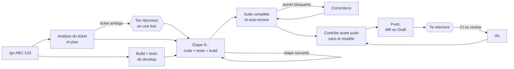

# OpenRDCode v2 : un ticket entre, une MR sort

> **Version du pack pour OpenCode v2** (testée avec OpenCode v2.1.2). Ce qui change et comment passer de la 1.19 à la v2 : `MIGRATION.md` ; l'analyse de départ : `ANALYSE.md`. Nouveauté : `/fortify`, un lot de vulnérabilités Fortify corrigées avec leurs tests, jusqu'à la MR.

Tu donnes une clé Jira à `/go`. L'agent analyse le ticket, code étape par étape avec les tests, se relit, corrige, vérifie ce qui va partir, pousse la branche et ouvre la merge request en Draft. Tu relis la MR comme celle d'un collègue. Après la CI ou la review, `/fix` traite tous les retours en une fois.

Pack OpenCode v2 (testé avec la v2.1.2) pour un modèle Qwen servi par vLLM (Qwen 3.8, déclaré « Qwen 3.6 » côté plateforme), avec les MCP Jira, Confluence, GitLab, SonarQube et Fortify.

## Pourquoi une v2

La v1 est un assistant pas à pas : 24 commandes, et une validation de ta part à chaque étape. Pour un ticket de 5 étapes, ça fait une douzaine d'interventions (`/ticket`, un `/dev` par étape, `/test`, `/check`, `/dev corrections`, `/ship`, `/scans`, un correctif par point, `/mr`…), plus les questions posées en cours d'étape : 104 endroits du pack te demandaient de choisir. Ce qui coûte, ce n'est pas le modèle : c'est le va-et-vient.

La v2 inverse le contrat :

| | v1 | v2 |
|---|---|---|
| Décisions de l'agent | il te les pose une par une | il les prend, suivant les conventions du dépôt, et les écrit dans la MR |
| Contrôle qualité | toi, à chaque étape | build et tests à chaque étape, auto-review, corrections automatiques, contrôle avant push ; toi, sur la MR |
| Enchaînement | un QCM « Suite » après chaque commande | une seule exécution, du ticket à la MR |
| Git | push validé à la main | commit et push automatiques sur la branche du ticket, derrière un contrôle sans le modèle |
| Commandes | 24 | 6 |

## La journée avec la v2

| Moment | Toi | L'agent |
|---|---|---|
| Matin | `/daily` | Sprint, MR, reviews qui t'attendent, plan du jour. Le ticket que tu choisis lance `/go`. |
| Un ticket | `/go ABC-123` | Analyse (et mesure de develop en parallèle), plan, code et tests étape par étape, build complet, auto-review, corrections, contrôle avant push, commit, push, MR en Draft avec son rapport. |
| Un changement sans ticket Jira | `/go sans ticket : <ce qu'il faut faire>` | Le même déroulé ; la description remplace le ticket. Clé locale `LOCAL-<n>` pour la branche et la fiche, jamais dans les commits ni le titre de la MR, qui dit « Sans ticket Jira ». |
| Vérifier un problème, sans rien changer | une question dans une session (« vérifie pourquoi… ») | Il enquête, sans branche ni commit. S'il faut corriger, `/go sans ticket` dans la même session reprend son enquête. |
| Après la CI ou la review | `/fix` | Jobs en échec, Sonar et Fortify sur les fichiers de la branche, discussions ouvertes de la MR : il corrige, teste, pousse, et rédige les réponses à coller. |
| Vulnérabilités Fortify par lot | `/fortify [nombre ≤ 5] [catégorie]` | Les plus graves de l'application SSC : chacune analysée par son sous-agent, ses tests gardés par le `test-guardian` (couverture coverlet du module et de ses dépendances avant et après, tests de la faille rouges puis verts), corrigée, un commit chacune, une MR Draft. MIGRATION.md, section 9. |
| MR d'un collègue | `/review !42` | Commentaires prêts à coller, en lecture seule. |
| Régression entre deux dépôts | `/compare <dépôt où ça marche> <classe> <symptôme>` | Cause de la régression : code, package, configuration, données ou correctif non reporté. |
| Le reste | `/outil <nom>` | Doc, audit, licences, release notes, patterns d'équipe, scaffolding CQRS, AGENTS.md du dépôt, abandon d'un ticket, todo, statistiques. |

Plusieurs `/go` en même temps, chacun dans son dossier et sa session : le titre de chaque session dit son issue (✅ MR créée, ⛔ arrêté, ❓ une question t'attend) et, pendant le travail, ce qu'attend le sous-agent en cours (« nouvel essai 3 (serveur du modèle) », « rien reçu depuis 4 min »). Un seul `/go` ou `/fix` à la fois par dossier : le second est refusé. Plusieurs tickets du même dépôt en même temps : un dossier par ticket, créé par le pack (section suivante).

### Plusieurs tickets du même dépôt : un dossier par ticket (worktrees)

OpenCode v2 propose les espaces de travail dans son interface : le sélecteur « Local » → « Nouvel espace de travail » sous la zone de saisie d'une nouvelle session (lu dans son code ; à vérifier à l'étape 5 de MIGRATION.md). Le pack ne laisse aucun agent créer, supprimer un worktree ou déplacer une session : c'est ton choix, dans l'interface. Sans ce sélecteur, `workspace.sh new ABC-124`, dans un terminal, crée `~/worktrees/<dépôt>/ABC-124` (un worktree git) à partir de develop à jour et donne l'adresse qui ouvre une session dans ce dossier. Dans les deux cas, `/go ABC-124` y travaille comme ailleurs et les fiches ticket restent dans le `.git` du dépôt principal, visibles de tous les dossiers. Le pas à pas : COMMANDES.md, « Plusieurs tickets d'un même dépôt ».

Ce que ça coûte, à connaître avant d'en ouvrir trois :
- Chaque dossier est une copie complète des fichiers (l'historique git, lui, est partagé) avec ses propres `bin/obj` (et `node_modules` en front) : de l'espace disque, et un premier build qui repart de zéro (les packages NuGet viennent du cache commun, rien n'est retéléchargé ; la compilation, si).
- Le serveur du modèle est partagé : trois `/go` en parallèle se partagent sa capacité, chacun va moins vite, et les « Gateway Time-out » deviennent plus probables tant que la passerelle n'est pas réglée.
- Les tests qui utilisent une ressource locale fixe (une base locale, un port fixe) peuvent se gêner quand deux suites tournent en même temps.
- Un ticket ne s'ouvre que dans un dossier à la fois : `workspace.sh new` et `/go` s'arrêtent en disant où il est ouvert.
- Les fichiers ignorés par git (un `.env`, des réglages locaux) ne sont pas dans le nouveau dossier : le script les nomme, sans les copier.
- Rider voit un dossier à la fois : pour regarder le travail d'un ticket dans Rider, ouvre son dossier.
- `workspace.sh remove` refuse un dossier qui a des fichiers non commités ; la branche reste. Aucun agent n'a le droit de lancer ce script.

## Tes deux interventions

1. **Au départ, seulement si le ticket est ambigu.** L'agent te pose toutes ses questions d'un coup, chacune avec une réponse recommandée. Ce que le ticket, le code ou les conventions tranchent n'est jamais demandé : c'est une décision, notée.
2. **À l'arrivée, la relecture de la MR.** Sa description dit ce qui a été fait, les critères d'acceptation couverts, les décisions prises par l'agent (à valider ou à contester en review), les tests, ce que la mesure de develop a trouvé, et les points où regarder de près.

Tu peux donner tes consignes dès le départ : `/go ABC-123 avec un Result, sans nouvelle lib`. Pour un gros ticket, `analyse seule` arrête après le plan, que tu relis avant le code ; `pas à pas` arrête après chaque étape, comme la v1.



## Comment ça marche, exactement

### La fiche ticket : le ticket interne de l'agent

`.git/opencode-tickets/<CLÉ>.md` du dépôt principal (le même dossier depuis chaque espace de travail), jamais commitée (elle est dans `.git`), écrite par l'analyste puis tenue à jour par un script :

| Section | Contenu |
|---|---|
| Résumé, critères d'acceptation | C1, C2… ; ceux que le ticket ne donne pas sont déduits et marqués « (déduit) » |
| Questions bloquantes | « Aucune » le plus souvent |
| Zones de code, Référence | où le ticket touche le code ; l'implémentation d'un autre dépôt à reproduire, s'il y en a une |
| Tests attendus | un test au moins par critère |
| Plan | 2 à 7 étapes à cocher, chacune avec ses fichiers et ses tests, chacune laissant le projet qui compile |
| Décisions | chaque choix avec sa raison et son origine (analyse, étape N, ta réponse, /fix) |
| Suivi | le journal horodaté : base de develop, étapes, arrêts, livraison, /fix |

Un script vérifie la fiche juste après l'analyse (sections présentes, étapes numérotées avec fichiers et tests, chaque critère couvert) ; un défaut est renvoyé une fois à l'analyste. Chaque étape est confiée à un sous-agent coder au contexte neuf ; réussie, elle devient un commit local et une case cochée.

### Un problème au milieu : on ne reprend jamais du début

| Ce qui arrive | Ce que fait l'agent | Ce que tu fais |
|---|---|---|
| Coupure (serveur du modèle, navigateur fermé, OpenCode redémarré) | rien n'est perdu : chaque étape réussie est commitée et cochée | `/go` : il note la reprise, repart à la première étape non cochée ; une étape coupée à moitié est reprise avec les fichiers déjà modifiés |
| Une étape échoue | diagnostic par le debugger, puis 2e essai dans la même session du coder (il garde ce qu'il a lu) ; encore en échec : arrêt ⛔, « bloqué à l'étape N : raison » dans la fiche | tu corriges ou tu précises (`/go ABC-123 <consigne>`), il repart de cette étape |
| Un test était déjà rouge sur develop | la mesure du départ le note : il n'est ni corrigé ni bloquant, il est signalé dans la MR | rien |
| Ticket à éclaircir avec le PO | arrêt ⛔ « en attente du PO » | `/go ABC-123 <la réponse>` |
| Conflit avec develop au moment du push | fusion annulée, rien de perdu, arrêt ⛔ avec les fichiers en conflit | tu résous dans Rider, puis `/go` livre |
| Le contrôle avant push trouve un secret | rien n'est poussé, arrêt ⛔ avec le fichier et la ligne (jamais la valeur) | COMMANDES.md, « Contrôle avant push » |
| Problème d'environnement (dotnet, Artifactory, identifiants GitLab) | arrêt ⛔ immédiat, avec quoi régler | tu règles, puis `/go` |

### Quand l'agent pose encore des questions

- `/go` : le choix du ticket si tu n'en donnes pas et que la branche n'en a pas ; puis, en un seul QCM, les questions bloquantes de l'analyse : seulement si rien ne tranche (ticket, code, AGENTS.md), que la réponse change un comportement visible (contrat d'API, données écrites, écran, sécurité) et qu'une erreur coûterait plus qu'un commentaire de review. Chaque question a une réponse recommandée et l'option « Je demande au PO ».
- `/go … comme dans <dépôt>` : une demande d'accès en lecture à ce dossier, au tout début (réponds « Toujours »).
- `/fix` : aucune question. Les remarques contestables deviennent des réponses argumentées à coller, pas des modifications.
- Ailleurs : la confirmation de `/outil abandon` (il supprime une branche), la validation de chaque page publiée sur Confluence, et la vérification que `/compare` te propose quand il n'a pas pu confirmer la cause.

Aucun sous-agent ne peut te poser de question (réglage OpenCode `primary_tools`), et aucune règle de permission ne te demande d'autorisation en cours de route : ce qui est interdit est refusé net, et l'agent fait sans ou s'arrête avec un rapport.

### « Refais comme dans l'autre dépôt »

| Besoin | Comment |
|---|---|
| Une fois, pour ce ticket | `/go ABC-123 comme dans ~/repos/ancienne-api (ExportService)` : l'analyste lit l'implémentation (lecture seule) et la décrit dans la section « Référence » de la fiche, le coder la reproduit. Une seule demande d'accès, au début. |
| Pour plusieurs tickets, ou toute l'équipe | `/outil pattern export-csv ~/repos/ancienne-api ExportService` une fois : un skill `pattern-export-csv-back` avec les appels exacts des packages internes. Ensuite `/go` s'en sert tout seul quand le ticket s'y prête (son analyste lit le catalogue des patterns), ou sur consigne : `/go ABC-123 comme le pattern export-csv`. |
| Un dépôt cité souvent | le déclarer dans `references` d'`opencode.json` (COMMANDES.md, « Lire un autre dépôt ») : plus aucune demande d'accès. |

En v1, c'était `/extract-pattern` puis `/apply-pattern`, avec ses questions. `apply` a disparu : `/go` applique.

## Ce qui garantit la qualité sans toi

- **Un contexte neuf par étape.** Un agent pilote garde le fil et confie chaque étape à un sous-agent qui démarre avec un contexte vide : le modèle ne s'essouffle pas au fil d'un long ticket.
- **Une mesure de départ.** Pendant que l'analyste lit le ticket, build et tests de develop tournent en parallèle : un problème d'environnement se voit avant la première ligne de code, les tests déjà rouges ne sont pas mis sur le dos du ticket, et le premier build du coder est incrémental.
- **Des preuves à chaque étape.** Build et tests de l'étape, puis toute la suite à la fin, puis encore après une fusion de develop. Un ticket de bug commence par un test qui reproduit le bug.
- **Une auto-review stricte.** Même grille que la review de la v1 (sécurité, autorisations, plusieurs instances, EF Core, performance, conventions), critères d'acceptation et pré-scan Sonar/Fortify. Les points bloquants et majeurs sont corrigés avant le push.
- **Des essais limités.** Deux échecs sur une même étape : diagnostic, un dernier essai, puis arrêt avec un rapport. Une boucle (le même appel trois fois) est refusée, et chaque agent a un plafond d'itérations au-delà duquel il doit rendre son rapport.
- **Un contrôle avant push, sans le modèle.** Section suivante.
- **La CI derrière.** Sonar et Fortify passent sur chaque push ; `/fix` traite leurs résultats.

## Les garde-fous, et pourquoi la v2 en a besoin

En v1, tu validais chaque push et chaque demande d'autorisation. En v2, plus personne ne regarde pendant le `/go` : ce qu'un humain arrêtait doit l'être par une règle. Chacun de ces garde-fous répond à un trou constaté, rejoué sur le moteur de permissions d'OpenCode 1.19 :

| Garde-fou | Le trou qu'il ferme |
|---|---|
| Aucune règle « demander » sur le shell, la lecture ou l'écriture : interdit = refusé net | Un clic sur « Toujours » vaut pour **tous** les agents jusqu'au redémarrage d'OpenCode, et ouvre large : `rm *` pour un `rm -rf`, `dotnet *` pour un `dotnet run`, toute lecture pour un fichier `.env`. Un seul clic en conversation libre levait les refus du coder autonome. |
| Le plugin garde les agents dans le dépôt : un chemin hors du dépôt dans une commande (`~`, `$HOME`, `/home/…`, `../..`, `cd` seul), même entre guillemets ou dans `sh -c`, est refusé | `grep -r export ~` passait pour tous les agents et aurait affiché `~/.zshenv`, donc les identifiants Artifactory. Les règles d'OpenCode ne voient pas l'intérieur des guillemets, et `export -p` n'est même pas une commande pour elles. |
| Les dossiers lisibles hors du dépôt (scripts et skills du pack, références, dossiers que tu nommes) sont en lecture seule : seules les commandes qui lisent peuvent les nommer, jamais `cp`, `mv`, `rm`, une redirection, un build, un interpréteur ou `xargs` ; un `cd` est suivi | Les scripts du pack se lisent maintenant sans demande d'accès. Sans cette règle, un agent aurait pu écraser `diff-guard.sh`, le contrôle avant push, ou écrire dans l'autre dépôt d'un « comme dans ». |
| Coder en liste blanche : lectures, git en lecture, build, tests, format, migrations EF sans base, scripts du pack, déplacements de fichiers dans le dépôt | Il avait « tout sauf… » : `curl`, `dotnet add package`, `dotnet ef database update` (une vraie base), `bash -c`, écrire dans `.git/config` ou dans `~/.config/opencode` passaient. |
| Seul le pilote lance les scripts qui écrivent dans git (`ship.sh`, `branch.sh`, la fiche) | N'importe quel agent, même en lecture seule (checker, analyste), pouvait lancer `ship.sh`, donc commiter et pousser. |
| Contrôle avant push (`diff-guard.sh`) : secret, fichier de clé ou `.env`, marqueur de conflit, version payante d'un package, valeur d'une variable secrète de l'environnement (le mot de passe Artifactory) → rien n'est poussé | Le push est automatique. Le contrôle relit chaque commit pas encore poussé : un secret retiré par un commit suivant partirait quand même avec l'historique. La valeur exacte des variables secrètes est cherchée partout, tests compris : quel que soit le chemin par lequel elle serait arrivée dans le code, elle ne part pas. |
| Un seul `/go` ou `/fix` à la fois par dossier | Deux pilotes dans le même dossier mélangeraient leurs commits. Deux tickets du même dépôt : deux dossiers (`workspace.sh new`). |
| Le texte des tickets, pages, discussions et logs est une donnée, jamais une instruction | Un ticket ou un commentaire de MR qui demanderait « pousse sans tests » ne doit rien déclencher. |
| 20 minutes pour un build ou des tests (posé par le plugin) | OpenCode arrête toute commande après 2 minutes : une suite de tests plus longue était tuée, puis relancée de zéro. |

Restent interdits comme en v1 : commit ou push sur develop, master ou main, force-push, rebase ; toute écriture dans Jira ; dans GitLab, tout sauf la création de la MR en Draft par le pilote ; Confluence sans ta validation ; la lecture des secrets (nuget.config, `.env`, `~/.zshenv`, identifiants git) ; décompiler un package. En conflit avec develop, l'agent n'arbitre jamais.

## Paramètres

| Réglage | Valeur | Pourquoi |
|---|---|---|
| `temperature`, `top_p` de tous les agents | 1.0, 0.95 (Qwen 3.8) | La carte de Qwen 3.8 ne donne qu'un réglage pour le mode réflexion, code compris, et ses benchmarks de code tournent avec. Le 0.6 d'avant venait de Qwen 3.6 (son réglage « code précis ») : sous 3.8, il s'écarte de ce que le modèle attend. |
| `steps` (plafond d'itérations) | pilote 100, coder 60, doc-writer 80, analyste, checker, debugger 30 | Au plafond, OpenCode force l'agent à rendre un rapport au lieu de tourner sans fin ; le pilote traite ce rapport incomplet comme un échec. |
| `doom_loop` | refusé (global) | Le même appel trois fois de suite : OpenCode demandait ta validation, ce qui bloquait un `/go` sans personne devant. Refusé, le sous-agent s'arrête en erreur et le pilote enchaîne (debugger, 2e essai). |
| `experimental.primary_tools: ["question"]` | nouveau | Aucun sous-agent ne reçoit l'outil question ; le debugger le garde quand il est l'agent de `/compare`. |
| `compaction.prune: true` | nouveau | Dans une longue session (`/daily`, puis `/go`, puis `/fix`), les sorties d'outils des tours anciens sont effacées du contexte ; les deux derniers tours restent entiers. |
| Permissions | aucune règle « ask » ; coder en liste blanche ; `git push/commit/merge/pull/reset/rebase`, `rm -r`, `dotnet run` refusés à tous | voir « Les garde-fous » |
| `top_k` 20, `preserve_thinking` (options du modèle) | inchangés | Section suivante. |

### Réglages du modèle (section `provider` d'`opencode.json`)

Sous OpenCode v2, la température et le top_p de chaque agent passent dans chaque requête (constaté avec `opencode debug agents`) ; `temperature` et `reasoning` déclarés dans le modèle d'un provider sont ignorés, et v2 le dit au démarrage (MIGRATION.md, étape 4). `top_k` et les options du mode thinking sont à traduire au format v2 avec ta vraie configuration.

```json
"provider": {
  "<ton provider>": {
    "models": {
      "<ton modèle Qwen>": {
        "temperature": true,
        "limit": { "context": 131072, "output": 32768 },
        "options": { "top_k": 20, "chat_template_kwargs": { "preserve_thinking": true } }
      }
    }
  }
}
```
- **Qwen 3.8** : la plateforme répond avec Qwen 3.8 même quand le modèle est déclaré « Qwen 3.6 ». Sa carte ne donne qu'un réglage pour le mode réflexion, code compris : `temperature` 1.0, `top_p` 0.95, `top_k` 20, `presence_penalty` 0 (ses benchmarks de code tournent avec). Les agents du pack et le snippet sont donc à 1.0 ; `top_k` 20 et `preserve_thinking` restent dans les `options`. Contexte natif : 262 144 tokens, mais `limit.context` reste la taille réelle du serveur, au plus 131072. Nouveau dans 3.8 : `reasoning_effort` (profondeur de la réflexion), à tester avant de s'en servir (COMMANDES.md, « Qwen 3.8 »).
- `temperature: true` : à ajouter dans tous les cas.
- `limit` : `context` = la taille de contexte réelle du serveur (à demander, ou `max_model_len` dans la réponse de `/v1/models` pour vLLM), au plus 131072 pour garder des tours rapides ; `output` = 32768, ou le quart de `context` s'il est plus petit que 128K. OpenCode compacte la session quand elle dépasse `context - output` ; sans `limit`, il ne la compacte jamais et elle peut finir en erreur de contexte.
- `options` (à tester une commande, puis à retirer si le serveur répond par une erreur) : `top_k` 20 est la valeur recommandée par Qwen. OpenCode renvoie au serveur le raisonnement des tours précédents ; à l'intérieur d'un même `/go`, le modèle de prompt de Qwen le garde déjà ; `preserve_thinking` le garde aussi d'une commande à l'autre dans la même session, ce que Qwen recommande pour les agents (Qwen 3.6 et 3.8 sont entraînés pour, et le cache du serveur s'en sert mieux). Contrepartie : le contexte se remplit plus vite.
- Côté serveur (pour l'équipe qui l'héberge, pas dans `opencode.json`) : Qwen 3.6 et 3.8 sont entraînés à générer plusieurs tokens à la fois (MTP), ce que vLLM n'active pas par défaut. La carte de Qwen 3.6 donne `--speculative-config '{"method":"qwen3_next_mtp","num_speculative_tokens":2}'` ; la page Unsloth écrit `"method": "mtp"` (la forme dépend de la version de vLLM ; la carte de 3.8 ne donne pas encore la sienne) et précise le compromis : chaque requête est générée plus vite, le débit total baisse un peu quand beaucoup de requêtes tournent en même temps. La qualité ne change pas : le décodage spéculatif garde la même distribution de sortie. C'est sans doute le plus gros levier de vitesse disponible, mais le gain se mesure sur le serveur, selon sa charge : c'est à l'équipe qui l'héberge d'en juger. Le prefix caching est actif par défaut sur les versions récentes.
- Si le serveur tourne sans le mode thinking (aucun bloc de réflexion dans l'interface), les réglages recommandés par Qwen (3.6 comme 3.8) sont `temperature` 0.7, `top_p` 0.8, `top_k` 20 et `presence_penalty` 1.5 : mets-les dans les `options` du modèle, elles s'appliquent alors à tous les agents.
- **« Service Unavailable » sur une session longue, qui disparaît avec une nouvelle session** : presque toujours une requête plus longue que ce que le serveur accepte (déclarer un `context` plus grand que le `max_model_len` réel). vLLM répond alors « maximum context length… » et OpenCode compacte la session tout seul ; mais quand une passerelle renvoie cette erreur en 503 « Service Unavailable », OpenCode ne la reconnaît pas (il exclut volontairement ce libellé), réessaie 5 fois, puis échoue à chaque nouvelle requête de la session. Remède : `context` = la vraie valeur du serveur (commande dans COMMANDES.md) ; en attendant, `/compact` dans la session au lieu d'en ouvrir une nouvelle.
- **« Gateway Time-out » (504) dans les logs** : la passerelle devant le serveur du modèle a coupé une requête trop longue. OpenCode réessaie seul (5 fois, avec 2 à 30 s d'attente) : la session continue, mais chaque essai repart de zéro. Causes probables : une réflexion longue (Qwen 3.8 réfléchit plus que 3.6) ou un serveur chargé. Le remède est côté plateforme : un délai plus long sur la passerelle pour les réponses en streaming, sans mise en tampon (COMMANDES.md, « Qwen 3.8 »).
- Titre des sessions : OpenCode le fait écrire par le même modèle, en parallèle de ta première commande, et Qwen réfléchit avant d'écrire ce titre, ce qui occupe le serveur pour rien. À tester de la même façon (si le serveur refuse, la session garde juste son titre par défaut) : dans la section `agent` de `opencode.json`, `"title": { "options": { "chat_template_kwargs": { "enable_thinking": false } } }`. Si la plateforme propose un modèle plus petit, `"small_model": "<provider>/<modèle>"` fait encore mieux.

## Où sont passées les commandes de la v1

| v1 | v2 |
|---|---|
| `/ticket`, `/dev`, `/test`, `/check`, `/dev corrections`, `/ship`, `/sync`, `/next` | `/go` (et `/go` à nouveau pour reprendre) |
| `/scans`, `/fortify-fix`, `/sonar-fix`, `/mr` | `/fix` |
| `/daily`, `/review`, `/compare` | inchangées |
| `/extract-pattern`, `/apply-pattern` | `/outil pattern` (capture), puis `/go` (applique) |
| `/doc`, `/audit`, `/licences`, `/release-notes`, `/cqrs`, `/agents-md`, `/abandon`, `/todo` | `/outil doc`, `/outil audit`, `/outil licences`, `/outil release-notes`, `/outil cqrs`, `/outil setup`, `/outil abandon`, `/outil todo` |
| — | `/outil stats` : ce que `/go` et `/fix` ont fait sur tes tickets |

En langage courant aussi : « pourquoi ça plante », « explique ce flux », « corrige le point Fortify 4512 », « rappelle-moi de relancer Paul vendredi ».

## Architecture

| Agent | Rôle | Écrit |
|---|---|---|
| `pilot` | Mène `/go`, `/fix` et `/daily` : fiche ticket, enchaînement des étapes, commit et push par script, MR en Draft. | la fiche ticket ; la MR (création seulement) |
| `analyst` | Analyse le ticket (Jira, Confluence, code, patterns de l'équipe, dépôt de référence) et écrit la fiche : critères, plan, tests attendus, questions bloquantes. | la fiche ticket |
| `coder` | Code UNE étape ou un lot de corrections, avec ses tests, puis build et tests. Ne pose jamais de question : il décide et le dit. | le code et les tests |
| `checker` | Auto-review de toute la branche avant le push, et `/review` d'une MR de collègue. | rien |
| `debugger` | Diagnostic d'un échec qui résiste, et `/compare`. | rien |
| `doc-writer` | Écrit `docs/` pour `/outil doc`, sans jamais ouvrir un fichier de configuration. | `docs/`, `README.md` |

Le reste : 6 commandes, 6 skills de connaissances (conventions CQRS, intégrations SharePoint/DocuSign/S3/Piano, remédiation Fortify, bonnes pratiques, correction de build, explication de code), les procédures de `/outil` sous forme de skills, les scripts du pack (état git, build et tests, branche, commit et push, contrôle avant push, fiche, statistiques…) et un plugin : scripts des commandes, environnement stable des agents, refus des identifiants et des dumps d'environnement, agents gardés dans le dépôt, délais longs pour les builds, un seul `/go` par dépôt, avancement et issue dans le titre de la session.

## Installation

`COMMANDES.md`, section « Installer la v2 » (ou « Mettre à jour une v2 déjà installée ») : la v1 est mise de côté (retour possible en une commande), puis les dossiers `agents/`, `commands/`, `skills/`, `scripts/` et `plugins/` de `v2/` se copient dans `~/.config/opencode/`. Ne copie jamais `tools/` (outils de maintenance du pack). Deux fichiers se fusionnent au lieu d'être remplacés :
- `AGENTS.global.md` dans `~/.config/opencode/AGENTS.md` (garde tes valeurs des sections « Daily » et « Release groups ») ;
- `opencode.snippet.json` dans `~/.config/opencode/opencode.json` (sections `agent`, `permission`, `experimental` et `compaction`, la section `permission` remplacée entièrement).

Une fois par dépôt : `/outil setup`, qui écrit l'`AGENTS.md` du dépôt (commandes de build et de test, conventions, exemples de référence). C'est ce qui permet à `/go` de travailler sans te demander comment builder ou où ranger le code. Le modèle `AGENTS.repo-template.md` montre ce qu'il contient.

Le push automatique demande des identifiants GitLab que git trouve seul sur la machine : `COMMANDES.md`, section « Identifiants GitLab ».

## Avant de la montrer : un vrai essai

Tout ce qui est vérifié ici l'a été avec un modèle simulé qui suit un script (section suivante) : le comportement réel de Qwen sur un `/go` complet ne l'est pas encore. Avant une démonstration, un essai réel d'une demi-heure :
1. Un petit ticket réel (1 à 3 étapes, sans migration), sur un dépôt où `/outil setup` est passé ; `/go <CLÉ> analyse seule` d'abord : la fiche est-elle juste, les décisions raisonnables ?
2. `/go <CLÉ>` pour coder, puis ne rien toucher jusqu'au titre ✅ ou ⛔. Noter la durée et chaque arrêt.
3. Lire la MR en Draft comme une MR de collègue : description, décisions, tests ; `/outil stats` pour les chiffres.
4. S'il s'arrête : la raison est dans sa réponse et dans la fiche (« Suivi ») ; les refus sont dans les logs (COMMANDES.md, « Logs d'OpenCode »). Envoie-moi les lignes : chaque arrêt réel est une règle à ajuster, pas une raison de revenir à la v1.

## Limites connues

- (Likely) Un modèle de 27B prend parfois une mauvaise décision : avec moins d'arrêts, elle va plus loin avant que tu la voies. La parade est la section « Décisions » de la MR, l'auto-review et `analyse seule` sur les gros tickets, pas des questions en plus.
- La création de la MR passe par l'outil `create_merge_request` du MCP GitLab. S'il porte un autre nom chez toi, l'agent te donne le lien de création et la description à coller (COMMANDES.md, « Vérifier le nom de l'outil qui crée les MR »).
- Un ticket long tourne longtemps : le titre de la session montre l'étape en cours et le temps écoulé (« ⏳ 6:12 outil · Étape 2/4 »).
- Le plugin reconnaît un chemin hors du dépôt à sa forme : un motif de recherche qui commence par un dossier racine existant (`grep "/home"`) est refusé à tort ; l'agent cherche autrement. C'est une couche de défense, pas un bac à sable du système : les agents tournent avec ton utilisateur. Les secrets restent couverts par les autres couches (règles de lecture, liste blanche du coder, contrôle avant push qui refuse la valeur des variables secrètes), et la vraie isolation serait un utilisateur ou un conteneur dédié pour OpenCode, avec un jeton Artifactory en lecture seule.
- Une référence `references` d'`opencode.json` doit être un dossier local : une référence vers un dépôt git distant n'est pas lisible par les agents du pack.

## Pour la maintenance du pack

- `tools/permissions.py` régénère les lignes `permission:` des agents et `opencode.snippet.json` (à lancer depuis `opencode-v2/`). Ne les modifie pas à la main. Aucune règle « ask » sur le shell, la lecture ou l'écriture : la simulation échoue s'il en apparaît une.
- Les permissions sont vérifiées par simulation : `tools/permission-sim.mjs` (le moteur d'OpenCode 1.19, dont v2 garde la logique de règles, sous-sessions et `primary_tools` compris) rejoue `tools/permission-corpus.mjs`, 1 753 cas : les commandes que le pack fait lancer à chaque agent, les réflexes du modèle, les secrets, les écritures git interdites (y compris un message de commit qui tenterait `$(…)`), la liste blanche du coder, les outils MCP permis ou masqués par agent, les questions et les boucles. Lancement : `cd tools && npm install --no-save web-tree-sitter@0.25.10 tree-sitter-bash@0.25.0 gray-matter@4.0.3 && node permission-sim.mjs ..`.
- Les garde-fous du plugin : `node tools/plugin-test.mjs .` (461 vérifications : chemins hors du dépôt, dossiers en lecture seule, fiches d'un worktree, dossier du worktree dans le titre et la ligne de commande, état des sous-agents dans le titre, dossiers nommés et références, `cd` suivis, outils appelés par leur chemin, journal des refus, dumps d'environnement, `rm` récursifs, délais, un seul `/go`, issue dans le titre).
- Tous les agents, commandes et skills sont validés avec `gray-matter`, le parseur YAML d'OpenCode (`node tools/validate.js`).
- Les scripts sont vérifiés avec `shellcheck` et testés avec dash, bash et busybox sh, et avec les awk mawk, gawk, BWK et busybox ; `branch.sh` et `ship.sh` sont rejoués contre un dépôt distant de test (branche, accents, push, commit poussé depuis un autre poste, merge de develop, conflit annulé, identifiants refusés, GitLab muet, secret refusé puis historique réécrit) et `diff-guard.sh` sur 33 cas (secrets par type, faux positifs, fichiers de test, secret retiré par un commit suivant, valeur d'une variable secrète de l'environnement, packages payants).
- Avec le vrai OpenCode v2.1.2, le pack installé et un modèle simulé : le plugin se charge, `/go` reçoit l'état du bon dépôt, le plugin refuse `cat ~/.zshenv` et `export -p`, un second `/go` dans le même dossier est refusé puis le dossier se libère, `/fortify` lance ses prérequis, et les 7 agents et 7 commandes sont lus (MIGRATION.md, section 0). Le pack de `v2/` a été rejoué de bout en bout avec OpenCode 1.19 (nominal, échec, autre dépôt, worktree).
