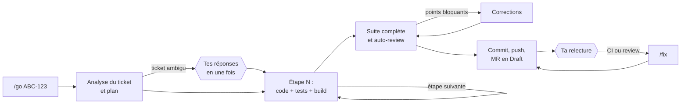

# OpenRDCode v2 : un ticket entre, une MR sort

Tu donnes une clé Jira à `/go`. L'agent analyse le ticket, code étape par étape avec les tests, se relit, corrige, pousse la branche et ouvre la merge request en Draft. Tu relis la MR comme celle d'un collègue. Après la CI ou la review, `/fix` traite tous les retours en une fois.

Pack OpenCode 1.19 pour un modèle Qwen 3.6 27B servi par vLLM, avec les MCP Jira, Confluence, GitLab, SonarQube et Fortify.

## Pourquoi une v2

La v1 est un assistant pas à pas : 24 commandes, et une validation de ta part à chaque étape. Pour un ticket de 5 étapes, ça fait une douzaine d'interventions (`/ticket`, un `/dev` par étape, `/test`, `/check`, `/dev corrections`, `/ship`, `/scans`, un correctif par point, `/mr`…), plus les questions posées en cours d'étape : 104 endroits du pack te demandaient de choisir. Ce qui coûte, ce n'est pas le modèle : c'est le va-et-vient.

La v2 inverse le contrat :

| | v1 | v2 |
|---|---|---|
| Décisions de l'agent | il te les pose une par une | il les prend, suivant les conventions du dépôt, et les écrit dans la MR |
| Contrôle qualité | toi, à chaque étape | build et tests à chaque étape, auto-review, corrections automatiques ; toi, sur la MR |
| Enchaînement | un QCM « Suite » après chaque commande | une seule exécution, du ticket à la MR |
| Git | push validé à la main | commit et push automatiques sur la branche du ticket |
| Commandes | 24 | 6 |

## La journée avec la v2

| Moment | Toi | L'agent |
|---|---|---|
| Matin | `/daily` | Sprint, MR, reviews qui t'attendent, plan du jour. Le ticket que tu choisis lance `/go`. |
| Un ticket | `/go ABC-123` | Analyse, plan, code et tests étape par étape, build complet, auto-review, corrections, commit, push, MR en Draft avec son rapport. |
| Après la CI ou la review | `/fix` | Jobs en échec, Sonar et Fortify sur les fichiers de la branche, discussions ouvertes de la MR : il corrige, teste, pousse, et rédige les réponses à coller. |
| MR d'un collègue | `/review !42` | Commentaires prêts à coller, en lecture seule. |
| Régression entre deux dépôts | `/compare <dépôt où ça marche> <classe> <symptôme>` | Cause de la régression : code, package, configuration, données ou correctif non reporté. |
| Le reste | `/outil <nom>` | Doc, audit, licences, release notes, patterns, scaffolding CQRS, AGENTS.md du dépôt, abandon d'un ticket, todo. |

## Tes deux interventions

1. **Au départ, seulement si le ticket est ambigu.** L'agent te pose toutes ses questions d'un coup, chacune avec une réponse recommandée. Ce que le ticket, le code ou les conventions tranchent n'est jamais demandé : c'est une décision, notée.
2. **À l'arrivée, la relecture de la MR.** Sa description dit ce qui a été fait, les critères d'acceptation couverts, les décisions prises par l'agent (à valider ou à contester en review), les tests et les points où regarder de près.

Tu peux aussi donner tes consignes dès le départ : `/go ABC-123 avec un Result, sans nouvelle lib`. Avec `pas à pas` dans les consignes, l'agent s'arrête après chaque étape, comme la v1.



## Ce qui garantit la qualité sans toi

- **Un contexte neuf par étape.** Un agent pilote garde le fil et confie chaque étape à un sous-agent qui démarre avec un contexte vide : le modèle ne s'essouffle pas au fil d'un long ticket.
- **La fiche ticket comme mémoire.** `.git/opencode-tickets/<CLÉ>.md` (jamais commitée) contient les critères, le plan, les décisions et le suivi. Un `/go` interrompu (coupure du serveur du modèle, fermeture du navigateur) reprend où il s'était arrêté.
- **Des preuves à chaque étape.** Build et tests de l'étape, puis toute la suite à la fin. Un ticket de bug commence par un test qui reproduit le bug.
- **Une auto-review stricte.** Même grille que la review de la v1 (sécurité, autorisations, plusieurs instances, EF Core, performance, conventions), critères d'acceptation et pré-scan Sonar/Fortify. Les points bloquants et majeurs sont corrigés avant le push.
- **Des essais limités.** Deux échecs sur une même étape : diagnostic par le debugger, un dernier essai, puis arrêt avec un rapport. L'agent ne tourne jamais en rond.
- **La CI derrière.** Sonar et Fortify passent sur chaque push ; `/fix` traite leurs résultats.

## Ce qui reste interdit

- Jamais de commit ni de push sur develop, master ou main, jamais de force-push, jamais de rebase : un script fait tous les commits et push, et les agents n'ont pas d'autre accès en écriture à git.
- La seule écriture dans GitLab est la création de la MR en Draft, par l'agent pilote. Jamais d'écriture dans Jira. Confluence seulement par `/outil doc` ou `/outil release-notes`, avec ta validation à chaque page.
- Les secrets sont protégés comme en v1 : aucun agent ne lit nuget.config, `.env`, `~/.zshenv` ni les identifiants git, et aucune commande ne peut poser une variable d'environnement ou un identifiant.
- En conflit avec develop, l'agent n'arbitre jamais : il annule la fusion et te donne les fichiers en conflit.

## Où sont passées les commandes de la v1

| v1 | v2 |
|---|---|
| `/ticket`, `/dev`, `/test`, `/check`, `/dev corrections`, `/ship`, `/sync`, `/next` | `/go` (et `/go` à nouveau pour reprendre) |
| `/scans`, `/fortify-fix`, `/sonar-fix`, `/mr` | `/fix` |
| `/daily`, `/review`, `/compare` | inchangées |
| `/doc`, `/audit`, `/licences`, `/release-notes`, `/extract-pattern`, `/apply-pattern`, `/cqrs`, `/agents-md`, `/abandon`, `/todo` | `/outil doc`, `/outil audit`, `/outil licences`, `/outil release-notes`, `/outil pattern`, `/outil cqrs`, `/outil setup`, `/outil abandon`, `/outil todo` |

En langage courant aussi : « pourquoi ça plante », « explique ce flux », « corrige le point Fortify 4512 », « rappelle-moi de relancer Paul vendredi ».

## Architecture

| Agent | Rôle | Écrit |
|---|---|---|
| `pilot` | Mène `/go`, `/fix` et `/daily` : fiche ticket, enchaînement des étapes, commit et push par script, MR en Draft. | la fiche ticket ; la MR (création seulement) |
| `analyst` | Analyse le ticket (Jira, Confluence, code) et écrit la fiche : critères, plan, tests attendus, questions bloquantes. | la fiche ticket |
| `coder` | Code UNE étape ou un lot de corrections, avec ses tests, puis build et tests. Ne pose jamais de question : il décide et le dit. | le code et les tests |
| `checker` | Auto-review de toute la branche avant le push, et `/review` d'une MR de collègue. | rien |
| `debugger` | Diagnostic d'un échec qui résiste, et `/compare`. | rien |
| `doc-writer` | Écrit `docs/` pour `/outil doc`, sans jamais ouvrir un fichier de configuration. | `docs/`, `README.md` |

Le reste : 6 commandes, 6 skills de connaissances (conventions CQRS, intégrations SharePoint/DocuSign/S3/Piano, remédiation Fortify, bonnes pratiques, correction de build, explication de code), les procédures de `/outil` sous forme de skills, les scripts du pack (état git, build et tests, branche, commit et push…) et un plugin (scripts des commandes, environnement stable des agents, garde contre l'écriture d'identifiants, avancement dans le titre de la session).

Les agents autonomes (`pilot`, `coder`, `checker`) ne sont jamais bloqués par une demande d'autorisation : ce qui est interdit est refusé net, et l'agent passe à autre chose ou s'arrête avec un rapport.

## Installation

`COMMANDES.md`, section « Installer la v2 » : la v1 est mise de côté (retour possible en une commande), puis les dossiers `agents/`, `commands/`, `skills/`, `scripts/` et `plugins/` de `v2/` se copient dans `~/.config/opencode/`. Ne copie jamais `tools/` (outils de maintenance du pack). Deux fichiers se fusionnent au lieu d'être remplacés :
- `AGENTS.global.md` dans `~/.config/opencode/AGENTS.md` (garde tes valeurs des sections « Daily » et « Release groups ») ;
- `opencode.snippet.json` dans `~/.config/opencode/opencode.json` (sections `agent` et `permission`).

Une fois par dépôt : `/outil setup`, qui écrit l'`AGENTS.md` du dépôt (commandes de build et de test, conventions, exemples de référence). C'est ce qui permet à `/go` de travailler sans te demander comment builder ou où ranger le code. Le modèle `AGENTS.repo-template.md` montre ce qu'il contient.

Le push automatique demande des identifiants GitLab que git trouve seul sur la machine : `COMMANDES.md`, section « Identifiants GitLab ».

## Limites connues

- (Likely) Un modèle de 27B prend parfois une mauvaise décision : avec moins d'arrêts, elle va plus loin avant que tu la voies. La parade est la section « Décisions » de la MR et l'auto-review, pas des questions en plus.
- La création de la MR passe par l'outil `create_merge_request` du MCP GitLab. S'il porte un autre nom chez toi, l'agent te donne le lien de création et la description à coller.
- Un ticket long tourne longtemps : le titre de la session montre l'étape en cours et le temps écoulé.

## Réglages du modèle (section `provider` de `opencode.json`, inchangés depuis la v1)

OpenCode 1.19 n'envoie la température d'un agent que si le modèle déclare `"temperature": true`. Pour un modèle déclaré à la main dans `provider` (cas d'un serveur interne), la valeur par défaut est `false` : sans cette ligne, le `temperature: 0.6` des agents est ignoré et le serveur applique la sienne. `top_p` est toujours envoyé ; `top_k` jamais, sauf dans les `options` du modèle, qui sont ajoutées telles quelles à chaque requête et l'emportent sur les valeurs des agents.

```json
"provider": {
  "<ton provider>": {
    "models": {
      "<ton modèle Qwen>": {
        "temperature": true,
        "limit": { "context": 131072, "output": 32768 },
        "options": { "top_k": 20, "chat_template_kwargs": { "preserve_thinking": true } }
      }
    }
  }
}
```
- `temperature: true` : à ajouter dans tous les cas.
- `limit` : `context` = la taille de contexte réelle du serveur (à demander, ou `max_model_len` dans la réponse de `/v1/models` pour vLLM), au plus 131072 pour garder des tours rapides ; `output` = 32768, ou le quart de `context` s'il est plus petit que 128K. OpenCode compacte la session quand elle dépasse `context - output` ; sans `limit`, il ne la compacte jamais et elle peut finir en erreur de contexte.
- `options` (à tester une commande, puis à retirer si le serveur répond par une erreur) : `top_k` 20 est la valeur recommandée par Qwen ; `preserve_thinking` garde le raisonnement des tours précédents, ce que Qwen recommande pour les agents (moins de raisonnement répété, meilleur cache du serveur).
- Côté serveur (pour l'équipe qui l'héberge, pas dans `opencode.json`) : Qwen 3.6 27B sait générer plusieurs tokens à la fois (MTP), mais vLLM ne l'active pas par défaut. Avec vLLM 0.17 ou plus : `--speculative-config '{"method": "mtp", "num_speculative_tokens": 1}'` (la recette vLLM du modèle mesure environ ×2,4 en génération sur de vraies requêtes d'agent de code), sans changement de qualité : la sortie suit la même distribution. Le prefix caching est actif par défaut sur les versions récentes.
- Si le serveur tourne sans le mode thinking (aucun bloc de réflexion dans l'interface), les réglages recommandés par Qwen sont `temperature` 0.7, `top_p` 0.8, `top_k` 20 et `presence_penalty` 1.5 : mets-les dans les `options` du modèle, elles s'appliquent alors à tous les agents.
- **« Service Unavailable » sur une session longue, qui disparaît avec une nouvelle session** : presque toujours une requête plus longue que ce que le serveur accepte (déclarer un `context` plus grand que le `max_model_len` réel). vLLM répond alors « maximum context length… » et OpenCode compacte la session tout seul ; mais quand une passerelle renvoie cette erreur en 503 « Service Unavailable », OpenCode ne la reconnaît pas (il exclut volontairement ce libellé), réessaie 5 fois, puis échoue à chaque nouvelle requête de la session. Remède : `context` = la vraie valeur du serveur (commande dans COMMANDES.md) ; en attendant, `/compact` dans la session au lieu d'en ouvrir une nouvelle.
- Titre des sessions : OpenCode le fait écrire par le même modèle, en parallèle de ta première commande, et Qwen réfléchit avant d'écrire ce titre, ce qui occupe le serveur pour rien. À tester de la même façon (si le serveur refuse, la session garde juste son titre par défaut) : dans la section `agent` de `opencode.json`, `"title": { "options": { "chat_template_kwargs": { "enable_thinking": false } } }`. Si la plateforme propose un modèle plus petit, `"small_model": "<provider>/<modèle>"` fait encore mieux.

## Environnement de la machine (inchangé depuis la v1)

OpenCode lance chaque commande d'un agent avec `<shell> -c "<commande>"`, dans le dossier du projet. Le shell est celui de la clé `"shell"` d'`opencode.json`, sinon le `$SHELL` du serveur, sinon bash. Un zsh lancé ainsi lit **seulement `~/.zshenv`** : ni `~/.zshrc`, ni ton `zshrc_perso`. C'est pourquoi un `dotnet` qui marche dans ton terminal peut être « introuvable » pour l'agent.

1. `opencode.json`, au premier niveau (le chemin est la sortie de `command -v zsh` dans ton terminal) :
```json
"shell": "/usr/bin/zsh",
```
2. `~/.zshenv` (DOTNET_ROOT = le dossier qui contient l'exécutable `dotnet` ; dans ton terminal : `dirname "$(readlink -f "$(command -v dotnet)")"`) :
```sh
export DOTNET_ROOT="<ce dossier>"
export PATH="$DOTNET_ROOT:$HOME/.dotnet/tools:$PATH"
```
   PATH sert à trouver `dotnet` ; DOTNET_ROOT sert aux exécutables qui cherchent le runtime eux-mêmes (hôte de test de `dotnet test` en .NET 10, outils globaux comme `dotnet-ef`). Les deux sont nécessaires. Pour le front, même chose avec le dossier de `node` quand il vient de nvm. `~/.zshenv` est lu avant **chaque** commande d'un agent : rien qui affiche quelque chose, rien de lent (pas de `source` de nvm ou d'oh-my-zsh). Les vérifications sont dans `COMMANDES.md`.
3. Artifactory : `dotnet restore` lit `artifactory_user` et `artifactory_password` dans l'environnement de la commande. S'ils ne sont que dans `zshrc_perso`, l'agent ne les a que si le serveur OpenCode a été démarré depuis un terminal qui les avait chargés. Si `build-test.sh` répond « ENVIRONMENT PROBLEM: the package feed (Artifactory) refused access », déplace ces deux `export` de `zshrc_perso` vers `~/.zshenv`. Les agents ne peuvent lire ni `~/.zshenv`, ni `~/.zshrc*`, ni les fichiers NuGet (permissions).
4. GitLab : un agent ne peut jamais taper un identifiant (git ne lui en demande pas, pour qu'aucune commande ne reste bloquée) : git doit trouver tes identifiants GitLab tout seul, avec un gestionnaire d'identifiants de cette machine. Le test, le réglage durable (un token réservé à cette machine, limité au code, avec un rappel `/outil todo` avant son expiration) et le dépannage sans rien sur le disque (un cache en mémoire, à refaire chaque matin) : `COMMANDES.md`, section « Identifiants GitLab ». Les agents ne peuvent pas lire ces identifiants (`git credential`, le cache, `security` et `secret-tool` leur sont refusés).
5. Redémarre OpenCode (`opencode-web.sh stop && opencode-web.sh start`), puis vérifie dans une nouvelle session : « lance `sh ~/.config/opencode/scripts/build-test.sh --build-only` ».

Réglages du **serveur** OpenCode (dans `opencode-web.sh`, avant le démarrage, pas dans `opencode.json`) :
```sh
export OPENCODE_DISABLE_MODELS_FETCH=1   # modèle interne : pas d'appel à models.dev
export OPENCODE_DISABLE_AUTOUPDATE=1     # installation à la main
export OPENCODE_DISABLE_LSP_DOWNLOAD=1   # pas de téléchargement de binaire LSP
```

## Pour la maintenance du pack

- `tools/permissions.py` régénère les lignes `permission:` des agents et `opencode.snippet.json` (à lancer depuis `v2/`). Ne les modifie pas à la main. Les agents autonomes (`pilot`, `analyst`, `coder`, `checker`, `doc-writer`) n'ont aucune règle « ask » : ce qui demanderait une validation leur est refusé, pour qu'aucun `/go` ne reste bloqué sur une question que personne ne voit.
- Les permissions sont vérifiées par simulation : `tools/permission-sim.mjs` (le moteur d'OpenCode 1.19) rejoue `tools/permission-corpus.mjs`, 1 403 cas : les commandes que le pack fait lancer à chaque agent, les réflexes du modèle, les secrets, les écritures git interdites (y compris un message de commit qui tenterait `$(…)`), les outils MCP permis ou masqués par agent. Lancement : `cd tools && npm install --no-save web-tree-sitter@0.25.10 tree-sitter-bash@0.25.0 gray-matter@4.0.3 && node permission-sim.mjs ..`.
- Tous les agents, commandes et skills sont validés avec `gray-matter`, le parseur YAML d'OpenCode (`node tools/validate.js`).
- Les scripts sont vérifiés avec `shellcheck` et testés avec dash, bash et busybox sh, et avec les awk mawk, gawk, BWK et busybox ; `branch.sh` et `ship.sh` sont rejoués contre un dépôt distant de test (branche, accents, push, commit poussé depuis un autre poste, merge de develop, conflit annulé, identifiants refusés, GitLab muet).
